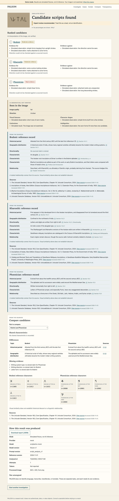
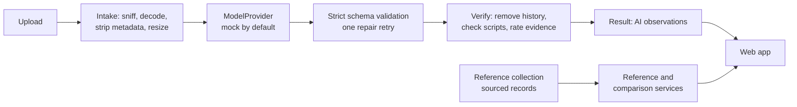

# PALEON

An evidence-first research tool for investigating historical writing systems from images.

PALEON reports what is visible in an image, names up to three candidate scripts with the evidence for and against each, and links them to sourced reference records. When an image does not support a conclusion, it says so.

> **Current status: runnable MVP in demo mode.** The application runs locally against simulated fixtures. **No real model has been called or evaluated, so PALEON makes no accuracy claim.**



## Quick start

Requires Node.js 22.12 or later. No API key or paid service is needed.

```bash
npm install
npm run dev
```

Open <http://127.0.0.1:5173>. Demo mode is the default, and every page says so.

| Command | Purpose |
|---|---|
| `npm run dev` | API on port 8787, web app on port 5173 |
| `npm start` | Build, then serve everything from <http://127.0.0.1:8787> |
| `npm test` | Complete offline test suite |
| `npm run local:image-check` | Check that a local model reads images. See [docs/LOCAL_DEMO.md](docs/LOCAL_DEMO.md) |
| `npm run validate:knowledge` | Validate the reference collection |

## Principles

1. **Evidence before explanation.** Observations and hypotheses are separate.
2. **The model may interpret an image, but it may never author history.** Historical facts and citations come only from stored records.
3. **Uncertainty is visible.** No percentages are shown, because model confidence is not a calibrated probability.
4. **Separate capabilities stay separate.** Script identification is not language identification, transcription, transliteration, or translation. The quick analysis does only the first. Research cases add person-confirmed readings, rule-based transliteration, and sourced glosses, each labelled, and no model reads the text.
5. **Simulated results are always labelled.**

## How it works



Model output and sourced records travel separately, and the interface shows them separately.

## Repository

| Path | Contents |
|---|---|
| `apps/api` | Hono API: intake, providers, analysis, references |
| `apps/web` | React and Vite interface |
| `packages/contracts` | Zod schemas shared by API and web |
| `knowledge/` | Curated script records and sources |
| `e2e/` | Browser tests |
| `experiments/m0_feasibility` | Python feasibility harness and dataset. Kept separate from the product |
| `docs/` | Architecture, decisions, guides |

Adding a writing system needs a validated record in `knowledge/`, and no code change.

## Documentation

| Topic | Document |
|---|---|
| Local setup and troubleshooting | [docs/LOCAL_SETUP.md](docs/LOCAL_SETUP.md) |
| API | [docs/API.md](docs/API.md) |
| Connecting a real model | [docs/MODEL_PROVIDER_GUIDE.md](docs/MODEL_PROVIDER_GUIDE.md) |
| Testing | [docs/TESTING.md](docs/TESTING.md) |
| Architecture | [docs/SYSTEM_ARCHITECTURE.md](docs/SYSTEM_ARCHITECTURE.md), [docs/AI_ARCHITECTURE.md](docs/AI_ARCHITECTURE.md) |
| Dataset and evaluation | [docs/DATASET_STRATEGY.md](docs/DATASET_STRATEGY.md), [docs/MODEL_EVALUATION.md](docs/MODEL_EVALUATION.md) |
| Security and data retention | [docs/SECURITY_AND_PRIVACY.md](docs/SECURITY_AND_PRIVACY.md) |
| Limitations and risks | [docs/RISKS_AND_LIMITATIONS.md](docs/RISKS_AND_LIMITATIONS.md) |
| Decisions and roadmap | [docs/DECISIONS.md](docs/DECISIONS.md), [docs/IMPLEMENTATION_ROADMAP.md](docs/IMPLEMENTATION_ROADMAP.md) |
| Current state | [docs/SESSION_HANDOVER.md](docs/SESSION_HANDOVER.md) |

## Known limitations

- Demo results are fixtures. They say nothing about your image.
- Six scripts are in the initial research scope, and three of the records have empty fields where no sourced claim exists.
- Reference records were checked by a non-specialist, and no epigrapher has reviewed them.
- Reference characters are modern Unicode forms, not attested letter shapes.
- The development dataset is a small convenience sample, and it is not representative of historical writing systems.

PALEON is a research aid. It does not authenticate, date, or value objects.
