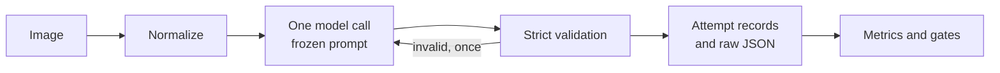

# AI Architecture

> **Version:** 0.3 | **Last updated:** 2026-11-01 | **Status:** Mixed. See the table below. Product code is Implemented and tested with fixtures, which says nothing about any model.

Related: [MODEL_EVALUATION.md](MODEL_EVALUATION.md), [MODEL_COMPARISON.md](MODEL_COMPARISON.md), [DATASET_STRATEGY.md](DATASET_STRATEGY.md), [DECISIONS.md](DECISIONS.md)

## Current versus planned

**No model has been called. Nothing here shows that any capability works on historical scripts.** In the table, "Implemented" means code exists. Offline tests verify code behaviour only.

| Capability | Experiment harness | Product | Notes |
|---|---|---|---|
| Vision-language model integration | Implemented. Only the approval-gated `live/stage_d.py` can reach its transport, and it has not run | Implemented, disabled by default, never run for real | `adapter.py` and `openaiCompatible.ts`, both tested with fakes |
| Script identification | Implemented as a prompt and schema, untested on a model | Implemented, untested on a model | Single call, no reference material |
| Abstention | Implemented as a prompt and schema, untested on a model | Implemented, untested on a model | Four dispositions |
| Output validation | Verified offline | Verified offline in Zod | `schema.py`, `validation.py`, `packages/contracts` |
| Image normalization | Verified offline through `LocalImageSource`. Unused so far, because no real image exists | Verified offline | `preprocess.py`, `images.py`, `intake.ts` |
| Language identification | Not in scope | Not planned for the MVP | The field stays `null` |
| OCR and transcription | Forbidden by the prompt | Could-have, Latin and Greek only | Needs measured CER |
| Transliteration | Not in scope | Not planned for the MVP | Needs per-script sign lists |
| Translation | Forbidden by the prompt | Not planned for the MVP | Reported as unavailable |
| Historical knowledge retrieval | Not in scope | Verified offline | Structured lookup by script ID |
| Two-stage Observe and Hypothesize | Not tested | Not built | ADR-002 stays Proposed. See ADR-054 |
| Evidence strength | Not in scope | Verified offline on adversarial fixtures | ADR-065. Strong needs sourced matches. See [API.md](API.md) |

## Separate operations

These are distinct tasks with different evidence requirements, and they must never share one prompt or endpoint.

| Operation | Question | Requires |
|---|---|---|
| Script identification | What writing system is this? | Visual evidence |
| Language identification | What language does it record? | Readable text. A script does not determine a language |
| OCR or transcription | Which signs are present? | A sign list and verified editions |
| Transliteration | How are the signs rendered in another script? | A conversion standard |
| Translation | What does it mean? | A language, a reading, and linguistic evidence |

## Experiment pipeline (Implemented, not yet run)



The response schema has no field for dates, sources, or URLs. A heuristic scan flags any such content in free text.

The dispositions are `identified`, `insufficient_evidence`, `outside_supported_set`, and `no_writing`. Abstaining responses may not include candidates, so rejection can be scored.

## Product pipeline as built (Implemented)

1. **Intake** validates and re-encodes the image in memory.
2. **Provider call** makes one request, using `apps/api/prompts/script_analysis_v1.md` and a strict schema.
3. **Validation** applies Zod. Invalid output gets one repair retry, then a 502.
4. **Verification** removes statements that look like dates, links, citations, or percentages, keeps as evidence only unique visual statements that do not name the candidate, refuses contradictory output, compares direction with the sourced record, and computes evidence strength (ADR-065).
5. **Reference lookup** happens separately, from stored records, and the interface labels it "From the sources".

The model output schema has no field for a date, source, URL, or confidence. The filters on free text are a backstop: they classify the form of a statement, and they can miss history mixed with a visual word. So the interface labels all model text as unverified AI observation.

Evidence strength does not show that evidence is true. Model text alone can reach moderate at most. Strong needs 2 confirmed sourced traits, and only direction can be confirmed today, so no result can be strong. It is not calibrated, and it has never been tested against real output.

| Output | Deterministic result |
|---|---|
| `candidates` or `out_of_scope` with `writingPresent: false` | `insufficient_evidence`, because the output contradicts itself |
| `candidates` on a poor image | `insufficient_evidence` |
| `no_writing` on a poor image | `insufficient_evidence`, because a poor image cannot show absence |
| `no_writing` on a usable image | Kept, with expert review recommended (ADR-049) |
| Direction against the sourced record | Weak. The candidate is never removed, because early inscriptions vary |
| Boustrophedon, vertical, or unclear | Not checkable, so never a conflict |

### Evidence linking review (Proposed)

The question is whether evidence should link to image regions, to verified source features, or to both. **They answer different questions, and neither proves a script.**

| | Verified source feature | Image region |
|---|---|---|
| What it would be | An ID for a sourced visual feature, stored per script | Coordinates of the marks a claim refers to |
| Deterministic check | The ID exists, belongs to that script, and is sourced | The box is valid and contains marks |
| What the check shows | The claim is about a documented feature | Where a human should look |
| What it cannot show | That the feature is really in this image | That the marks are that feature, or that the model read them |
| Needs | Sourced features. Only 2 `letter_form` traits exist today | Model output of usable coordinates, which is unproven |

**Recommendation:** build source features first, and treat regions as a reader's aid.

1. Source diagnostic visual features per script, with expert review. Without them, nothing can be checked.
2. Have the model cite feature IDs, in a new prompt and contract version. This would let a second sourced match exist, so Strong could become reachable, and it needs a new documented experiment.
3. Test region output separately. A region must never raise evidence strength: its value is letting a reader check the claim against the image.

Stop at step 1 if M0 fails.

## Product pipeline: earlier five-stage design (Proposed)

Kept for reference. The two-stage call and evidence-ID checks below are not built.

### Image handling

1. **Check the declared size** before reading the body, using Hono's `bodyLimit`. Its 100 KB default must be raised explicitly.
2. **Identify the type from magic bytes.** Ignore the filename and client `Content-Type`. Reject SVG, because it is executable markup rather than an image.
3. **Decode fully** with a pixel limit, which blocks decompression bombs.
4. **Re-encode** to a clean file. This removes EXIF data, including GPS, and defeats polyglot files.
5. **Resize to a per-provider limit.** Inscription detail is fine, and providers handle size differently. Groq counts 2,048 tokens per image for `qwen/qwen3.8-27b`, and Together caps images at a 2×2 grid of 560-pixel tiles. Downscaling can silently erase strokes, so `maxImageEdge` belongs in provider configuration.
6. **Support a user crop.** Letting the user select the inscribed area is the cheapest way to keep detail, so it is included in the UI.

### Stage 1: Observe (model)

The prompt asks for visual facts using a controlled tag vocabulary, and it names no scripts.

**Why this stage exists:** if the model names a script first, its "observations" tend to become justifications for that conclusion. Separating the stages produces an observation record uninfluenced by any hypothesis. The early exit also saves the second call on unusable images.

### Stage 2: Retrieve (deterministic)

Observation tags select diagnostic feature cards from the collection. With six scripts, all cards can fit in the prompt, so this step mainly orders and trims them.

**How this relates to RAG:** this is RAG with a structured lookup instead of embeddings. Retrieval, augmentation, and generation are all present. Embeddings solve a problem this project does not have yet, namely finding relevant text in a collection too large for the prompt.

Upgrade only if evidence requires it:

1. Tag lookup, for tens of scripts.
2. BM25 keyword search, for hundreds of records.
3. Embeddings in a vector store, when keyword recall is measured to be inadequate.

### Stage 3: Hypothesize (model)

Inputs are the image, the observations, and the cards. The output must validate against a strict schema:

- At most three candidates.
- `scriptId` must be a supported ID, or `null` with an `unverifiedLabel`.
- Each claim must cite a card's `evidenceId`.
- Contradicting features must be listed, not only supporting ones.
- "None of these" is always an allowed answer.

**The closed-set trap:** a model offered six labels will tend to choose one even for a script outside them. Providing an explicit way out, then testing it with out-of-scope images, is the countermeasure. Without this, accuracy on in-scope images says nothing about real use.

### Stage 4: Verify (deterministic)

| Check | On failure |
|---|---|
| Output parses and matches the schema | One repair retry, then 502 |
| Each `evidenceId` exists | Remove the claim and record it |
| The cited feature belongs to that candidate's script | Remove the claim and record it |
| The candidate retains at least one supported feature | Remove the candidate |
| Observed tags actually support the cited feature | Downgrade strength |

Evidence strength is then computed by a fixed rule from supported features, contradictions, and image quality. The rule is tuned only on the development split. Unsupported candidates can never exceed `weak`.

### Stage 5: Compose (deterministic)

The response is assembled from collection text by ID. This stage has no model call, so citations cannot be invented here.

### Structured output approach

Request the strongest mode each endpoint offers, then always validate locally. Provider enforcement cannot be the safety boundary. OpenRouter's documentation says `strict` enforcement varies by provider, and Groq's vision page documents JSON mode rather than schema enforcement.

### The `ModelProvider` interface

```ts
interface ModelProvider {
  readonly id: string;
  readonly limits: { maxImageEdge: number; structuredMode: "json_schema" | "json_object" };
  generateStructured(request: {
    system: string;
    userText: string;
    image?: { mimeType: string; bytes: Uint8Array };
    jsonSchema: object;
    schemaName: string;
    maxTokens: number;
    signal: AbortSignal;
  }): Promise<{
    content: string;
    modelId: string;
    usage: { inputTokens: number; outputTokens: number } | null;
    latencyMs: number;
  }>;
}
```

The interface returns raw text. Zod validation stays in the pipeline, so every provider is held to the same rule.

Provider failures map to one typed error set: `timeout`, `rate_limited`, `unavailable`, `credit_exhausted`, and `bad_response`.

Retry policy:

- Retry 429s and 5xx responses once, honouring `Retry-After`.
- Allow one repair retry for malformed output.
- Everything shares the 55-second request deadline.

## Model selection approach

Vendor claims justify testing a model, not trusting it. Measured performance on this task decides the choice. See [MODEL_COMPARISON.md](MODEL_COMPARISON.md).

## Hallucination mitigation and uncertainty (design; see "as built" above)

The strategy relies on making errors impossible by construction first, and detecting the remainder second.

| Risk | Control | Layer |
|---|---|---|
| Invented history or dates | The model has no field for them, and Compose uses collection text | Structural |
| Fabricated citations or URLs | The schema has no URL field, and sources resolve from IDs | Structural |
| Invented character examples | Examples come only from the collection | Structural |
| Hallucinated evidence ID | Verify removes it and records the event | Deterministic |
| Real ID cited for the wrong script | Ownership check | Deterministic |
| Overconfident ranking | Evidence strength is computed, and no percentages are shown | Deterministic |
| Forced choice among six labels | "None of these" path, tested with out-of-scope images | Prompt and evaluation |
| Observation bias | Observe runs before any script names are visible | Pipeline |
| Invented readings | Transcription is separate, gated by script, and keeps `illegible` units | Capability gate |
| Invented translation | The capability does not exist in the MVP | Capability gate |
| Similarity presented as descent | Fixed caveat on all comparisons; comparison text comes from the collection | Structural |
| Text in the image acts as a prompt injection | Model output is untrusted data; the model has no tools or URL fields | Structural |

### Outcome rules

| Condition | Outcome | `recommendExpertReview` |
|---|---|---|
| No writing observed | `no_writing_detected` | false in this design. True as built (ADR-065) |
| Image quality too poor for feature extraction | `insufficient_evidence` | true |
| Model selects none, or names only an unsupported script | `out_of_scope` | true |
| No candidate survives verification | `insufficient_evidence` | true |
| Top candidates are similar in strength, or rank 1 is below `strong` | `candidates` | true |
| Rank 1 is `strong` and clearly ahead | `candidates` | false |

### Presentation

The UI uses a separate label for each kind of statement: **Seen in your image**, **Possible interpretation**, and **From the sources**. Comparison glyphs are labelled as normalized reference forms, since real inscriptions vary.
