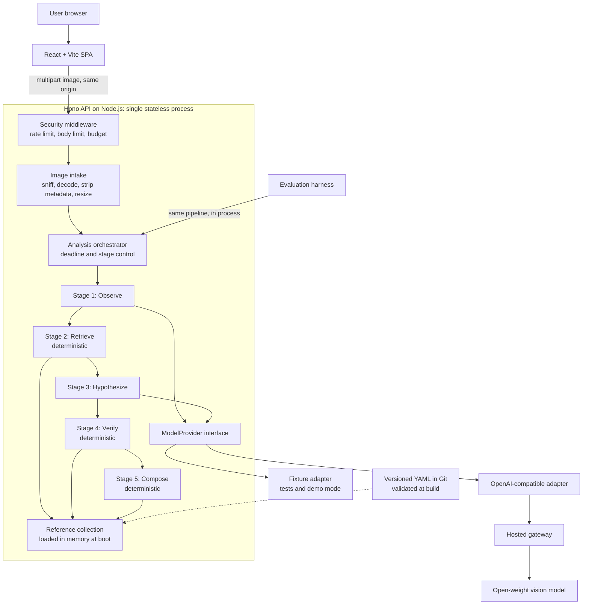
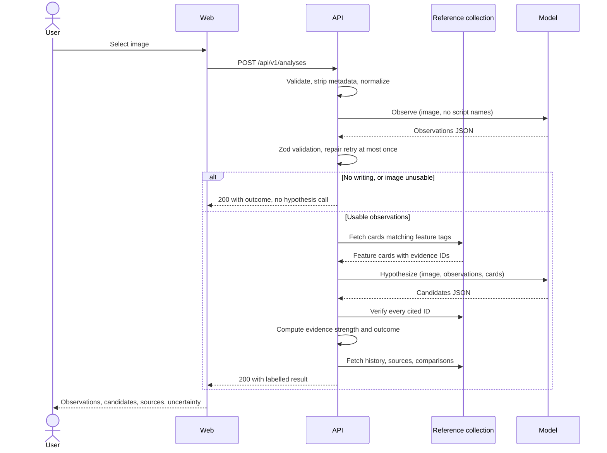

# ScriptEcho: Architecture and Solution Design

**Status:** Proposed, awaiting review. No application code exists yet.
**Prepared:** 2026-11-01. Model, price, and provider facts are a snapshot from that date.

**Evidence labels used in this document**

| Label | Meaning |
|---|---|
| **Verified** | Read on 2026-11-01 from official documentation, a model card, or a live provider catalog. Links are in [Sources](#sources). |
| **Assumption** | A planning estimate. Measure it before relying on it. |
| **Unverified** | Could not be confirmed. It must pass the [verification plan](#8-verification-plan) before use. |

No vision call has been made against any provider yet, so nothing here proves that a model can identify a historical script. Milestone M0 exists to test that.

---

## 0. Read this first: the deadline has passed

The Week 4 entry period closed at 12:29 PM IST today (11:59 PM PDT, October 31). The conversion in the brief is correct. This design was started at 1:45 PM IST, so the window closed about 76 minutes earlier.

The official rules also block a late start, separately from the submission date:

- The Week 4 rules require "a new project, created during the Entry Period."
- The official rules require you to confirm that "development of your Entry was started during, and not prior to, the Entry Period."
- The challenge FAQ says repositories "must be started and completed within the challenge window."
- The sponsor's servers are the official clock. I found no announced extension.

**Consequence:** this project cannot be a valid Week 4 entry. Backdating commits would falsify the eligibility confirmation, so it is not an option.

**Decision taken in this document:** ScriptEcho is planned as a portfolio-quality open-source release, targeted for **November 15, 2026**. The engineering standard does not change. [Section 15](#15-submission-checklist) keeps the DEV checklist for reference and marks which items no longer apply.

---

## 1. Product requirements and MVP boundaries

### Problem statement

People who meet an unfamiliar inscription have two poor options. A general chatbot gives a confident answer with unverifiable history. Specialist resources assume you already know what you are looking at.

ScriptEcho fills that gap. It reports what is visible, names up to three candidate scripts, and shows sourced evidence for each one. It says so plainly when the image does not support a conclusion.

### Core design rule

**The model may interpret the image. It may never author history.**

Every historical fact, date, citation, and character example comes verbatim from a curated reference collection. The model's output is limited to image observations, ranked candidates, and references to existing record IDs.

This enforces "evidence before explanation" through architecture. It is also why ScriptEcho is more than a chatbot wrapped in a UI.

### MVP scope: six scripts

| Script | Region | Why it is included |
|---|---|---|
| Brahmi | South Asia | Ancestor of later South Asian scripts, and the route to the future Bengali research track |
| Kharosthi | South Asia | Hard contrast with Brahmi |
| Phoenician | Eastern Mediterranean | Hard contrast with early Greek |
| Greek (epigraphic) | Mediterranean | Bridges Phoenician and Latin |
| Latin (Roman epigraphic) | Mediterranean, Europe | Control class, with the best transcription references |
| Runic | Northern Europe | Angular forms that can be mistaken for other inscribed scripts |

The set is deliberately built from **confusable pairs**. Distinct systems such as cuneiform or Egyptian hieroglyphs would inflate accuracy without testing much. They are used instead as *out-of-scope* evaluation images, where the correct behaviour is to decline to match them to a supported script.

Regional coverage is limited in the MVP. Expanding it is first in the post-MVP list, and the README must state the limitation.

### Requirements

| ID | Requirement | Priority |
|---|---|---|
| F1 | Upload JPEG, PNG, or WebP up to 8 MB, with type checked from file content | Must |
| F2 | Return structured observations, kept separate from hypotheses | Must |
| F3 | Return 0 to 3 ranked candidates, each with evidence | Must |
| F4 | Show historical context and sources from the reference collection only | Must |
| F5 | Compare candidates using documented features | Must |
| F6 | Return explicit `insufficient_evidence`, `out_of_scope`, and `no_writing_detected` outcomes | Must |
| F7 | Validate all model output with Zod and verify every evidence ID | Must |
| F8 | Handle timeouts, rate limits, malformed output, and provider outages | Must |
| F9 | Offer a labelled demo mode using recorded responses | Should |
| F10 | Experimental transcription for Latin and Greek only, enabled only after CER is measured | Could |
| Q1 | Publish a reproducible evaluation report | Must |
| Q2 | Keep the API key server-side and retain no uploads | Must |

### Explicitly out of scope for the MVP

- Translation of any script. The API reports it as unavailable.
- Language identification. The response field stays `null`, because a script does not determine a language.
- Accounts, databases, vector stores, multi-agent frameworks, and model training.
- PDF or multi-page input, and streaming.
- Dating, authentication, or valuation of artefacts.
- Claims about historical descent. Visual similarity is never presented as proof of a relationship.

### Success criteria

The release is complete when:

1. All six scripts have source-reviewed records.
2. The deployed demo handles a valid image, an out-of-scope image, and a non-writing image correctly.
3. All failure-path tests pass.
4. The evaluation report is reproducible from the repository.

The 88% figure is a research target. Missing it does not block release. Reporting it honestly is the requirement.

---

## 2. System architecture



Only two of the five stages call a model, and only those two can be wrong in an interesting way. The deterministic stages around them are what make the output trustworthy.

---

## 3. Component responsibilities and data flow

| Component | Owns | Must not do |
|---|---|---|
| React SPA | Upload, crop, staged progress, visual separation of evidence types | Hold keys, call the model, or reinterpret results |
| Security middleware | Rate limits, body limits, global daily budget, security headers | Contain domain logic |
| Image intake | Content sniffing, safe decode, EXIF removal, resizing, re-encoding | Write to disk or log image bytes |
| Orchestrator | Stage order, shared deadline, retry policy, degraded outcomes | Know any provider's request format |
| Observe stage | Image description with no script names available | See the reference collection |
| Retrieve stage | Selecting records using observation tags | Call a model |
| Hypothesize stage | Ranked candidates that cite record IDs | Emit URLs, dates, or free-form history |
| Verify stage | Reject unknown IDs, recompute evidence strength, decide outcome | Repair content by guessing |
| Compose stage | Build the response from verified IDs and collection text | Generate prose |
| `ModelProvider` | One vendor-neutral structured call | Hold pipeline logic |
| Reference collection | Claims, sources, features, and comparisons | Contain unsourced claims |
| Evaluation harness | Run labelled sets through the real pipeline | Use a separate code path |



The system is stateless. Images exist in memory for the length of a request, and the full result returns in one response. No job store is needed.

---

## 4. API definition

The base path is `/api/v1`, on the same origin as the SPA, so CORS stays closed. These are contract definitions. They become Zod schemas in `packages/contracts`, shared by the API and the web app.

| Method | Path | Purpose | Tier |
|---|---|---|---|
| `POST` | `/analyses` | Run the identification pipeline | Must |
| `GET` | `/scripts` | List supported scripts and capabilities | Must |
| `GET` | `/scripts/:id` | Fetch a script record with sources | Must |
| `GET` | `/comparisons?a=&b=` | Fetch a documented comparison | Should |
| `GET` | `/healthz` | Liveness, without calling the provider | Must |
| `POST` | `/transcriptions` | Experimental transcription | Could |

### `POST /api/v1/analyses`

Request: `multipart/form-data` with one required field, `image`. Maximum 8 MB.

```ts
type AnalysisResponse = {
  analysisId: string;
  outcome: "candidates" | "insufficient_evidence" | "out_of_scope" | "no_writing_detected";
  outcomeReason: string;                 // from a fixed template set, not model prose
  observations: {
    source: "model_observation";
    imageQuality: "good" | "fair" | "poor";
    medium: "stone" | "metal" | "clay" | "manuscript" | "other" | "unclear";
    writingDirection: "ltr" | "rtl" | "boustrophedon" | "vertical" | "unclear";
    damage: string[];
    visualFeatures: { tag: string; description: string }[];   // tag from a controlled vocabulary
    limitations: string[];
  };
  candidates: {                          // maximum 3, may be empty
    rank: 1 | 2 | 3;
    scriptId: string | null;             // null when the model names an unsupported script
    unverifiedLabel: string | null;      // shown as unsupported, with no history attached
    evidenceStrength: "strong" | "moderate" | "weak";   // computed by the Verify stage
    matchedFeatures: {
      evidenceId: string;
      documentedFeature: string;         // collection text
      imageObservation: string;          // model text, labelled as interpretation
    }[];
    contradictions: { evidenceId: string; note: string }[];
  }[];
  historicalContext: {                   // collection text only
    scriptId: string;
    claims: { claimId: string; text: string; sourceIds: string[] }[];
  }[];
  comparisons: {
    scriptIds: [string, string];
    differences: { text: string; sourceIds: string[] }[];
    caveat: string;                      // fixed: similarity does not establish descent
  }[];
  sources: {
    id: string; title: string; publisher: string; url: string;
    accessedOn: string; locator: string | null;
  }[];
  capabilities: {
    languageIdentification: "unavailable";
    transcription: "unavailable" | "experimental";
    translation: "unavailable";
  };
  recommendExpertReview: boolean;
  meta: {
    provider: string; modelId: string; promptVersion: string;
    collectionVersion: string; demoMode: boolean; latencyMs: number;
  };
};
```

Three choices in this contract are deliberate:

- **There is no numeric confidence.** Model-reported percentages are not calibrated probabilities. `evidenceStrength` is computed by a rule, so it can be inspected.
- **No model-supplied URL field exists.** A fabricated link cannot pass through a field that does not exist.
- **`insufficient_evidence` returns 200.** Abstaining is a correct result, not a failure.

### Errors

Errors use a single shape: `{ "error": { "code", "message", "retryable", "requestId" } }`.

| Status | Code | Cause |
|---|---|---|
| 400 | `invalid_request` | Missing or duplicate `image` field |
| 413 | `file_too_large` | Over 8 MB |
| 415 | `unsupported_media_type` | Content does not match an allowed format |
| 422 | `undecodable_image` | Corrupt, or over the pixel limit |
| 429 | `rate_limited` | Per-client limit reached, with `Retry-After` |
| 502 | `model_output_invalid` | Still invalid after one repair retry |
| 503 | `provider_unavailable` | Provider outage, its rate limit, or the daily budget is spent |
| 504 | `analysis_timeout` | The 55-second deadline was exceeded |

### `POST /api/v1/transcriptions` (Could, feature-flagged)

The request carries `image` and `scriptId`, and works only for scripts marked `experimental`.

The response returns a list of units. Each has `original`, `normalized`, and `status: certain | uncertain | illegible`. Lost or unreadable sections stay in the output as `illegible` rather than being filled in. Every character is checked against the script's allowed Unicode ranges. There is no paired translation.

---

## 5. Repository structure

```text
scriptecho/
├── apps/
│   ├── api/
│   │   ├── src/
│   │   │   ├── routes/            # Thin HTTP handlers
│   │   │   ├── middleware/        # Limits, budget, headers, errors
│   │   │   ├── intake/            # Image validation and normalization
│   │   │   ├── pipeline/          # observe, retrieve, hypothesize, verify, compose
│   │   │   ├── providers/         # ModelProvider, OpenAI-compatible, fixture
│   │   │   ├── prompts/           # Versioned prompts
│   │   │   └── knowledge/         # Loader and query functions
│   │   └── test/
│   └── web/
│       └── src/
│           ├── components/
│           ├── features/analysis/
│           └── api/
├── packages/
│   └── contracts/                 # Zod schemas shared by API, web, and eval
├── knowledge/
│   ├── sources.yaml
│   ├── features.yaml              # Controlled visual vocabulary
│   ├── scripts/                   # One YAML file per script
│   └── comparisons/
├── eval/
│   ├── manifest.yaml              # Labels, object IDs, licences, split
│   ├── images/                    # Only where the licence allows redistribution
│   ├── run.ts
│   ├── metrics.ts
│   └── reports/                   # Dated reports with config hashes
├── docs/
│   ├── ARCHITECTURE.md
│   ├── adr/
│   └── MODEL_AND_LICENSING.md
├── .env.example
├── LICENSE
├── README.md
└── package.json                   # npm workspaces
```

### Reference record shape

```yaml
# Shape only. Every value must come from a reviewed source.
id: <script-id>
name: <display name>
capabilities: { identification: true, transcription: unavailable }
unicode: { block: <block name>, ranges: [<range>] }
claims:
  - id: <script-id>.claim.<slug>
    kind: geography | chronology | usage
    text: <paraphrase in our own words>
    sourceIds: [<source-id>]
    locator: <page or section>
    reviewedOn: <date>
diagnosticFeatures:
  - id: <script-id>.feature.<slug>
    tags: [<controlled-vocabulary tag>]
    description: <visible feature>
    sourceIds: [<source-id>]
```

A build-time check fails if any claim lacks a source, a source lacks a URL or access date, or any cross-reference is broken.

---

## 6. AI pipeline

### Image handling

1. **Check the declared size** before reading the body, using Hono's `bodyLimit`. Its 100 KB default must be raised explicitly.
2. **Identify the type from magic bytes.** Ignore the filename and client `Content-Type`. Reject SVG, because it is executable markup rather than an image.
3. **Decode fully** with a pixel limit, which blocks decompression bombs.
4. **Re-encode** to a clean file. This removes EXIF data, including GPS, and defeats polyglot files.
5. **Resize to a per-provider limit.** Inscription detail is fine, and providers handle size differently. Groq counts 2,048 tokens per image for `qwen/qwen3.8-27b`, and Together caps images at a 2×2 grid of 560-pixel tiles. Downscaling can silently erase strokes, so `maxImageEdge` belongs in provider configuration.
6. **Support a user crop.** Letting the user select the inscribed area is the cheapest way to keep detail, so it is included in the UI.

### Stage 1: Observe (model)

The prompt asks for visual facts using a controlled tag vocabulary, and it names no scripts.

**Why this stage exists:** if the model names a script first, its "observations" tend to become justifications for that conclusion. Separating the stages produces an observation record uninfluenced by any hypothesis. The early exit also saves the second call on unusable images.

### Stage 2: Retrieve (deterministic)

Observation tags select diagnostic feature cards from the collection. With six scripts, all cards can fit in the prompt, so this step mainly orders and trims them.

**How this relates to RAG:** this is RAG with a structured lookup instead of embeddings. Retrieval, augmentation, and generation are all present. Embeddings solve a problem this project does not have yet, namely finding relevant text in a collection too large for the prompt.

Upgrade only if evidence requires it:

1. Tag lookup, for tens of scripts.
2. BM25 keyword search, for hundreds of records.
3. Embeddings in a vector store, when keyword recall is measured to be inadequate.

### Stage 3: Hypothesize (model)

Inputs are the image, the observations, and the cards. The output must validate against a strict schema:

- At most three candidates.
- `scriptId` must be a supported ID, or `null` with an `unverifiedLabel`.
- Each claim must cite a card's `evidenceId`.
- Contradicting features must be listed, not only supporting ones.
- "None of these" is always an allowed answer.

**The closed-set trap:** a model offered six labels will tend to choose one even for a script outside them. Providing an explicit way out, then testing it with out-of-scope images, is the countermeasure. Without this, accuracy on in-scope images says nothing about real use.

### Stage 4: Verify (deterministic)

| Check | On failure |
|---|---|
| Output parses and matches the schema | One repair retry, then 502 |
| Each `evidenceId` exists | Remove the claim and record it |
| The cited feature belongs to that candidate's script | Remove the claim and record it |
| The candidate retains at least one supported feature | Remove the candidate |
| Observed tags actually support the cited feature | Downgrade strength |

Evidence strength is then computed by a fixed rule from supported features, contradictions, and image quality. The rule is tuned only on the development split. Unsupported candidates can never exceed `weak`.

### Stage 5: Compose (deterministic)

The response is assembled from collection text by ID. This stage has no model call, so citations cannot be invented here.

### Structured output approach

Request the strongest mode each endpoint offers, then always validate locally. Provider enforcement cannot be the safety boundary. OpenRouter's documentation says `strict` enforcement varies by provider, and Groq's vision page documents JSON mode rather than schema enforcement.

### The `ModelProvider` interface

```ts
interface ModelProvider {
  readonly id: string;
  readonly limits: { maxImageEdge: number; structuredMode: "json_schema" | "json_object" };
  generateStructured(request: {
    system: string;
    userText: string;
    image?: { mimeType: string; bytes: Uint8Array };
    jsonSchema: object;
    schemaName: string;
    maxTokens: number;
    signal: AbortSignal;
  }): Promise<{
    content: string;
    modelId: string;
    usage: { inputTokens: number; outputTokens: number } | null;
    latencyMs: number;
  }>;
}
```

The interface returns raw text. Zod validation stays in the pipeline, so every provider is held to the same rule.

Provider failures map to one typed error set: `timeout`, `rate_limited`, `unavailable`, `credit_exhausted`, and `bad_response`.

Retry policy:

- Retry 429s and 5xx responses once, honouring `Retry-After`.
- Allow one repair retry for malformed output.
- Everything shares the 55-second request deadline.

---

## 7. Model selection

### Criteria, in order

1. **Licence:** open weights, with terms that allow this use.
2. **Image input through the chosen endpoint,** proven by a real call.
3. **Schema-constrained output** on that endpoint.
4. **Measured accuracy** on ScriptEcho's development set. This outranks every vendor claim.
5. **Latency:** p95 for both stages must fit the 55-second deadline.
6. **Cost and redundancy:** low per-analysis cost, with more than one host.

### Shortlist (live catalog snapshot, 2026-11-01)

Prices are USD per million input/output tokens from OpenRouter's public model API. They change frequently.

| Model | Licence | Price | Relevant documented claim | Main concern |
|---|---|---|---|---|
| **Qwen3-VL-30B-A3B-Instruct** (first to test) | Apache 2.0 | $0.15 / $0.60 | Card says "better with rare/ancient characters and jargon," with OCR in 32 languages | Older than Qwen3.8; the claim is the vendor's own and untested here |
| **Gemma 4 31B** | Apache 2.0 | $0.20 / $0.40, plus a `:free` variant | Visual budgets up to 1,120 tokens; card recommends higher budgets for OCR | The hub reported about 80 s request latency on Novita; the free variant lacks the `structured_outputs` flag |
| **Qwen3.8-27B** | Apache 2.0 | $0.15 / $1.875 | Newest of the group; 91.1 on OmniDocBench 1.5, per its card | Thinking is on by default at `xhigh`, which costs time and tokens; a modern-document benchmark says nothing about inscriptions |
| **Gemma 4 26B A4B** (budget baseline) | Apache 2.0 | $0.0675 / $0.225 | Same family, with the same OCR guidance | Likely weaker on hard cases, to be measured |

**Decision:** start with Qwen3-VL-30B-A3B-Instruct, because it alone makes a relevant claim about ancient characters. Treat that as a reason to test it first, not as a conclusion. The bake-off in M0 decides the final choice.

**Considered and excluded for now:**

| Model | Reason |
|---|---|
| Qwen3.8-Flash-Next | Hub lists a custom `qwen-community-1.0` licence |
| Kimi K3 | Custom licence, and the highest price in the set at about $15 per million output tokens |
| Llama 4 Scout | Described as a community licence with use restrictions by a secondary source, which I did not check against the primary licence; the Apache 2.0 options avoid the question |
| Gemma 3 | Superseded by Gemma 4, and its licence is the older Gemma terms |
| GLM-4.5V | OpenRouter lists no `structured_outputs` support |

### Gateway decision

| Gateway | Strengths | Weaknesses |
|---|---|---|
| **OpenRouter (primary)** | Per-key spending limits; `require_parameters`; `data_collection: "deny"`; `zdr` routing; free variants for prototyping | Free tier is 50 requests a day below 10 purchased credits; a further intermediary |
| **Hugging Face router (second adapter)** | OpenAI-compatible; no markup; provider pinning such as `model:provider`; per-provider status and structured-output flags in its catalog | Free accounts have no included credits; PRO includes $2 a month |
| Groq direct | Fast hardware; documented JSON mode | Only two vision models listed, one in limited preview; JSON mode rather than schema enforcement |
| Together direct | Documented vision API | Serverless vision catalog not confirmed |

Both gateways speak the same chat-completions format, so one adapter with two configurations covers them. That also proves the abstraction works, because the second gateway is a real swap.

### Estimated cost

**Assumption:** two calls per analysis, 5,000 input and 800 output tokens per call. Replace these with measured figures after M0.

| Model | Per analysis | One model, 120 images × 3 repeats |
|---|---|---|
| Qwen3-VL-30B | $0.0025 | $0.89 |
| Gemma 4 31B | $0.0026 | $0.95 |
| Qwen3.8-27B | $0.0045 | $1.62 |
| Gemma 4 26B | $0.0010 | $0.37 |

A **$10 capped key** should cover the full bake-off and the demo. Reaching 10 purchased credits also raises OpenRouter's free-variant limit to 1,000 requests a day.

---

## 8. Verification plan

Complete this in M0, and commit the results to `docs/MODEL_AND_LICENSING.md`. Treat every shortlist row as unproven until then.

| Claim | How to verify | Evidence to keep | Fails if |
|---|---|---|---|
| Model is available | Query `GET https://openrouter.ai/api/v1/models` and `GET https://router.huggingface.co/v1/models` | Dated JSON | Absent, or status not `live` |
| **The endpoint accepts images** | Send a real base64 image with a fact only the image contains | Request and response | The model cannot report that fact |
| Structured output works with images | Send a nested schema with an image, using `require_parameters: true` | 20-call pass rate | Under 90% parse on first attempt |
| Resolution survives | Send a test card of progressively smaller strokes | Finest detail the model reads | Detail lost at sizes the product needs |
| Licence | Read the licence file in the model repository, not only the listing badge | File link and date | Terms conflict with redistribution or the demo |
| Pricing | Compare the catalog against `usage` on real calls | Calculated versus billed cost | Differs materially from the estimate |
| Privacy | Read the provider policy; test `data_collection: "deny"` and `zdr: true` | Policy links and test result | No compliant endpoint for the model |
| Rate limits | Read official limits, then observe 429 behaviour | Documented and observed values | Limits cannot support the demo |
| Thinking control | Confirm `enable_thinking: false` or `reasoning` passes through the gateway | Token use with and without | The parameter is silently ignored |
| Failover | Disable the primary configuration and run the suite on the second | Passing run | Pipeline changes are required |

**Known trap:** catalog metadata alone cannot prove image support for a provider. Hugging Face's catalog shows Cerebras serving Qwen3.8-27B, a model with image input, while its provider table shows no vision (VLM) support for Cerebras. Only a real image call settles it.

Two more items are still open:

- DeepInfra's data policy could not be retrieved at the URL tried.
- The `zdr` page announces CSAM screening of inference requests from October 27, 2026, which should be confirmed and disclosed in the privacy notes.

---

## 9. Hallucination mitigation and uncertainty

The strategy relies on making errors impossible by construction first, and detecting the remainder second.

| Risk | Control | Layer |
|---|---|---|
| Invented history or dates | The model has no field for them, and Compose uses collection text | Structural |
| Fabricated citations or URLs | The schema has no URL field, and sources resolve from IDs | Structural |
| Invented character examples | Examples come only from the collection | Structural |
| Hallucinated evidence ID | Verify removes it and records the event | Deterministic |
| Real ID cited for the wrong script | Ownership check | Deterministic |
| Overconfident ranking | Evidence strength is computed, and no percentages are shown | Deterministic |
| Forced choice among six labels | "None of these" path, tested with out-of-scope images | Prompt and evaluation |
| Observation bias | Observe runs before any script names are visible | Pipeline |
| Invented readings | Transcription is separate, gated by script, and keeps `illegible` units | Capability gate |
| Invented translation | The capability does not exist in the MVP | Capability gate |
| Similarity presented as descent | Fixed caveat on all comparisons; comparison text comes from the collection | Structural |
| Text in the image acts as a prompt injection | Model output is untrusted data; the model has no tools or URL fields | Structural |

### Outcome rules

| Condition | Outcome | `recommendExpertReview` |
|---|---|---|
| No writing observed | `no_writing_detected` | false |
| Image quality too poor for feature extraction | `insufficient_evidence` | true |
| Model selects none, or names only an unsupported script | `out_of_scope` | true |
| No candidate survives verification | `insufficient_evidence` | true |
| Top candidates are similar in strength, or rank 1 is below `strong` | `candidates` | true |
| Rank 1 is `strong` and clearly ahead | `candidates` | false |

### Presentation

The UI uses a separate label for each kind of statement: **Seen in your image**, **Possible interpretation**, and **From the sources**. Comparison glyphs are labelled as normalized reference forms, since real inscriptions vary.

---

## 10. Testing and evaluation plan

### Automated tests

| Layer | Examples |
|---|---|
| Intake | Spoofed extension, SVG, polyglot, truncated file, oversized file, pixel bomb, EXIF stripped |
| Contracts | Valid and invalid fixtures for each schema |
| Knowledge | Every claim sourced, IDs unique, references resolve |
| Verify | Unknown ID, wrong-script ID, four candidates, unsupported-only result |
| Provider | Timeout, 429 with `Retry-After`, 500, 402, empty content, reasoning-only content, malformed JSON |
| Orchestrator | Early exit, one repair retry, shared deadline honoured |
| API | Status code and error shape for each failure, no secrets in responses |
| Web | Each outcome renders, and evidence labels remain distinct |
| Live smoke | One real call, run manually or nightly, never required for ordinary CI |

All normal tests use the fixture provider, so CI needs no key and has no cost.

### Evaluation dataset

| Split | Contents | Size |
|---|---|---|
| Development | In-scope images, used freely for prompts and rules | 30 (5 per script) |
| Test: in-scope | Locked until prompts are frozen | 60 (10 per script) |
| Test: out-of-scope | Other scripts, such as cuneiform, hieroglyphs, Maya, and undeciphered systems | 10 |
| Test: no writing | Decorative patterns, natural cracks, tool marks | 10 |
| Test: damaged | Worn or partial in-scope inscriptions, scored separately | 10 |

**Labelling rule:** each label cites an institutional catalogue record or a published edition. Each manifest row stores object ID, source URL, licence, and label evidence. Without domain expertise available, the report should say that labels were not independently reviewed by an epigrapher, or name the reviewer if one is found.

**Image rights:** every Wikimedia Commons file has its own licence and must be checked individually. Images without redistribution rights stay out of the repository, with links in the manifest instead.

### Metrics

| Metric | Definition | Target |
|---|---|---|
| Top-1 accuracy | Correct rank 1 on in-scope test images, with macro average and per-script results | 88% research target |
| Top-3 recall | Correct script appears in candidates | Report |
| Coverage | Share of in-scope images given a candidate rather than an abstention | Always report beside accuracy |
| Out-of-scope rejection | Correctly declines to match a supported script | Report |
| No-writing rejection | Correctly returns `no_writing_detected` | Report |
| Character error rate | Levenshtein edits ÷ reference length, only where a verified edition exists, with normalization documented | Report if F10 ships |
| Citation validity | Displayed source IDs resolve, and URLs respond | 100% |
| Claim support | Sampled manual check that each source actually supports the claim | 100% of sample |
| Schema validity | First-pass and after-repair rates | Report both |
| Evidence ID violations | Invalid IDs from the model, before filtering | Report |
| Latency | p50 and p95, for each stage and overall | Report |
| Failure rate | Timeouts, 429s, and 5xx by provider | Report |

Each report also needs a confusion matrix, the model, provider, prompt version, collection version, and dates. Runs should be repeated three times, because hosted output can vary even at temperature 0.

### Honest limits of the result

**Accuracy can be raised by abstaining.** A system that answers only easy images scores well. Accuracy must never appear without coverage.

**The sample is too small to prove 88%.** These are 95% Wilson intervals:

| Result | 95% interval |
|---|---|
| 53 of 60 (88.3%) | 77.8% to 94.2% |
| 106 of 120 (88.3%) | 81.4% to 92.9% |
| 176 of 200 (88.0%) | 82.8% to 91.8% |
| 9 of 10 for one script | 59.6% to 98.2% |

To have the interval's lower bound clear 88%, you would need about 78 of 82 correct (95% observed), or 213 of 231 (92% observed).

So the report should read, for example, "53 of 60 on this six-script set, 95% CI 78% to 94%." It should not say that ScriptEcho is 88% accurate. Per-script results at n=10 are descriptive only.

**The result does not generalize.** It covers six scripts, in the photography styles collected, as selected by one person. It cannot establish accuracy across historical scripts, because no small set can represent thousands of years of scribal, regional, and material variation.

### Data leakage

| Leak | Control |
|---|---|
| Same object in different splits | Split by physical object, not by image |
| Near-duplicate photographs or crops | Perceptual-hash check across splits |
| Model recognizes a famous object, rather than reading its script | Prefer lesser-known objects, and report a famous-object subgroup |
| Filename or metadata reveals the label | Random filenames, stripped metadata |
| Evaluation images appear as reference examples | Keep them disjoint |
| Prompt tuning on the test set | Freeze prompts by Git commit first, and record any re-run |
| Test images were public during model training | Cannot be ruled out, so disclose it |

---

## 11. Security, privacy, and deployment

### Security

- **Secrets:** server-side environment variables only, with a `.env.example` and secret scanning in CI. The frontend bundle is checked for the key prefix in CI.
- **Spending:** a per-key OpenRouter limit is the hard stop, backed by an application daily request budget. Rate limits alone do not protect the wallet.
- **Abuse:** per-IP limits, in memory, which is adequate for a single instance. Concurrency is capped, because each request holds an image in memory.
- **Upload attack surface:** covered by [image handling](#image-handling). There is no URL-fetch feature, which removes server-side request forgery entirely.
- **Output handling:** React escaping, no raw HTML rendering, and links only from the reference collection.
- **Headers:** a strict Content-Security-Policy, `X-Content-Type-Options: nosniff`, and `Referrer-Policy`.
- **Dependencies:** lockfile committed, with automated update checks.

### Privacy

- Uploaded images are not stored and are never logged. Logs contain request ID, stage, timing, and error class only.
- Images are necessarily sent to a third-party model host. The UI must say so before upload, and warn against uploading private or sensitive material.
- Set `data_collection: "deny"` on requests. If a free endpoint is used, read its terms first, and avoid free endpoints in the public demo.

### Responsible use

The README should state that ScriptEcho is not an authentication, dating, or valuation tool. It should also acknowledge that some inscriptions are culturally sensitive and that a model's reading of them may be unwelcome or wrong.

### Reference material licensing

| Material | Rule |
|---|---|
| Unicode data files | Usable under Unicode License v3 |
| **Unicode code charts** | Do **not** redistribute. Unicode's terms limit them to personal or internal use, and bar extracting fonts from them. Link to them instead. |
| Comparison glyphs | Render from an openly licensed font after checking its licence, such as a Noto font (licence unverified here) |
| Encyclopaedias and scholarly text | Paraphrase, cite, and link. Never copy passages. |
| Wikimedia Commons images | Follow each file's licence and credit its author |

### Deployment

**Decision:** a single Node service on Render serves both the API and the built SPA.

This avoids CORS, requires one deployment, and lets the key sit in one place. Hono serves static files through `@hono/node-server/serve-static`, and it should serve only the built output directory.

The free tier's documented limits are:

- Spin-down after 15 minutes idle.
- About one minute to wake.
- 750 instance hours a month.
- No persistent disk, which does not matter for a stateless service.

**Handling cold starts:** wake the service before any live demo, and show a clear waiting state. The recorded walkthrough protects against this entirely. Upgrade to a paid instance only if a live event requires it.

Basic operations: `/healthz`, structured logs, and a rollback by redeploying the previous commit.

---

## 12. Implementation schedule

**Assumption:** about 3 focused hours a day. Scale the dates to your real availability.

| Milestone | Dates | Deliverable | Exit gate |
|---|---|---|---|
| **M0: Feasibility** | Nov 2–3 | Verification plan run; three models tested on the development images, outside the application | **Go/no-go** below |
| **M1: Foundation** | Nov 4–5 | Workspace, contracts, intake, `ModelProvider`, fixture adapter, CI | Failure tests pass with no key |
| **M2: Knowledge** | Nov 6–7 | Six reviewed script records, comparisons, build validation | Validator passes, sources manually checked |
| **M3: Pipeline** | Nov 8–9 | All five stages and error mapping | End-to-end run with live and fixture adapters |
| **M4: Interface** | Nov 10–11 | Upload, crop, result views, all outcomes | Each outcome demonstrated |
| **M5: Evaluation** | Nov 12–13 | Prompt freeze, locked test run, report | Report reproducible from a clean clone |
| **M6: Release** | Nov 14–15 | Deployment, security pass, README, article, walkthrough | Fresh-machine setup succeeds |

**M0 go/no-go,** using the 30 development images:

- **Continue as designed** if the best model places the correct script in its top three on at least 70% of images. This is a practical planning threshold, not a statistical one.
- **Reduce scope** to four scripts if a specific confusable pair causes most of the failures.
- **Change the product** if results remain poor. The fallback is a guided identification tool, where the user answers visual questions and the collection does the matching. It would remain useful and honest, but the model would be a minor component.

**Cut order if time runs short:** transcription, then the second gateway adapter, then the crop tool, then two scripts. The evaluation report and failure handling are never cut.

**Post-MVP order:**

1. More scripts, starting with underrepresented regions.
2. The Bengali evolution track.
3. BM25 retrieval.
4. Transcription.
5. Fine-tuning experiments, once a larger dataset exists.

---

## 13. Architectural decisions

Each decision becomes an ADR in `docs/adr/`.

### ADR-1: The reference collection owns all historical content

- **Why necessary:** it is the only reliable way to guarantee no fabricated facts or citations.
- **Alternative:** let the model write context from retrieved passages, then check it afterward.
- **Trade-off:** answers are less fluent, and coverage is limited to reviewed content.
- **How to verify:** confirm the response schema has no model-authored history or URL field, and run a test that fails if any displayed claim is missing from the collection.

### ADR-2: Separate Observe and Hypothesize stages

- **Why necessary:** it keeps observations independent from conclusions, and allows an early exit.
- **Alternative:** one call returning everything, which is faster and cheaper.
- **Trade-off:** double the calls, and roughly double the latency and cost.
- **How to verify:** run both designs on the development set. If two stages show no improvement in accuracy or rejection, merge them and record why.

### ADR-3: Structured lookup instead of a vector store

- **Why necessary:** six scripts fit in a prompt, so semantic search solves nothing yet.
- **Alternative:** embeddings with a vector database.
- **Trade-off:** no fuzzy free-text search, and a tag vocabulary to maintain.
- **How to verify:** measure whether the correct script's card reaches the Hypothesize stage. Reconsider when the collection exceeds the prompt budget or recall falls.

### ADR-4: Six confusable scripts instead of broad coverage

- **Why necessary:** review effort is the true constraint, and hard pairs produce a meaningful test.
- **Alternative:** 20 or more scripts with shallow records.
- **Trade-off:** a narrower product, with limited regional coverage at launch.
- **How to verify:** compare confusion-matrix results for the pairs. If nothing is confused, the set is too easy.

### ADR-5: Computed evidence strength instead of model confidence

- **Why necessary:** model percentages are not calibrated, and users read them as probabilities.
- **Alternative:** display the model's score, or calibrate it statistically.
- **Trade-off:** coarse categories, and a rule that needs tuning.
- **How to verify:** check on the test set that `strong` results are correct more often than `moderate`, and `moderate` more often than `weak`. Calibration needs far more data, so this is an ordering check only.

### ADR-6: A single stateless service with synchronous responses

- **Why necessary:** no job store, queue, or database is needed for a short request.
- **Alternative:** background jobs with polling, or streaming progress.
- **Trade-off:** no real progress reporting, and a slow model blocks one request.
- **How to verify:** measure p95. If it exceeds the 55-second deadline, add server-sent progress, or reconsider the model.

### ADR-7: Gateway plus `ModelProvider` interface

- **Why necessary:** models and hosts change often, as the catalog data shows, and the brief requires replaceability.
- **Alternative:** a direct provider SDK, or a large abstraction framework.
- **Trade-off:** another intermediary, and a lowest-common-denominator interface.
- **How to verify:** switching to the second gateway must require configuration changes only.

### ADR-8: Local Zod validation regardless of provider guarantees

- **Why necessary:** enforcement varies by provider, and validation checks meaning that a JSON schema cannot.
- **Alternative:** trust strict structured output.
- **Trade-off:** extra code, and occasional retry cost.
- **How to verify:** track first-pass validity by provider, and test with injected malformed output.

### ADR-9: No training in the MVP

- **Why necessary:** there is no labelled dataset of adequate size, and the brief excludes it.
- **Alternative:** fine-tune a model, or train a classifier on script images.
- **Trade-off:** accuracy is limited by what hosted models already know.
- **How to verify:** use the confusion matrix and the M0 gate. Reconsider only with enough licensed data.

### ADR-10: Transcription and translation gated by capability

- **Why necessary:** each is a distinct task with distinct evidence requirements.
- **Alternative:** one "read this inscription" prompt, which looks impressive but invites invention.
- **Trade-off:** the MVP will disappoint users who want a translation.
- **How to verify:** enable transcription for a script only after CER is measured against verified editions.

### ADR-11: Reject non-writing and unknown scripts explicitly

- **Why necessary:** a closed-set classifier gives confident wrong answers.
- **Alternative:** always return the closest match with a warning.
- **Trade-off:** lower coverage, and some correct answers will be withheld.
- **How to verify:** measure out-of-scope and no-writing rejection alongside coverage.

### ADR-12: npm workspaces with shared contracts

- **Why necessary:** the API, web app, and evaluation harness must agree on one schema set.
- **Alternative:** separate repositories, or duplicated types.
- **Trade-off:** slightly more initial configuration.
- **How to verify:** a schema change should fail type checks everywhere it matters.

### ADR-13: Render single-service deployment

- **Why necessary:** it is the simplest route to a shareable demo.
- **Alternative:** static frontend hosting with a separate API, or Workers.
- **Trade-off:** cold starts on the free tier. Native image libraries also need Node rather than an edge runtime.
- **How to verify:** deploy in M1 rather than at the end, and measure cold-start and request timing.

---

## 14. Risk register

Likelihood and impact are judgments, not measurements. Risks are ordered by priority.

| # | Risk | Likelihood | Impact | Mitigation | Early signal |
|---|---|---|---|---|---|
| 1 | Hosted models cannot distinguish historical scripts well enough | Medium to high | Critical | M0 gate before building, scope reduction, guided fallback | Low top-3 on development images |
| 2 | Weak labelled data, from licensing limits or doubtful labels | High | High | Start in M0, use catalogue-sourced labels, link rather than redistribute | Fewer than 10 usable objects per script |
| 3 | Reference records contain subtle historical errors | Medium | High | Source every claim, seek one expert review, publish a corrections route | Sources disagree |
| 4 | Downscaling destroys diagnostic detail | Medium | High | Resolution test, crop tool, provider-specific limits | Thin strokes misread on resized images |
| 5 | Model or endpoint changes, or disappears | Medium | Medium | Pinned IDs, second gateway, dated catalog checks | Status change in the catalog |
| 6 | Structured output is unreliable alongside images | Medium | Medium | Repair retry, simpler schema, stricter endpoint routing | First-pass rate under 90% |
| 7 | Latency exceeds the deadline | Medium | Medium | Thinking off, smaller output limits, faster host | p95 over 45 s |
| 8 | Public demo is abused, or the budget runs out | Medium | Medium | Key spend limit, daily budget, demo mode | Spend spike |
| 9 | Users overtrust results | Medium | Medium | Evidence labels, no percentages, expert-review prompts | Feedback treating output as authoritative |
| 10 | Copyright problem in images, charts, or text | Low to medium | High | Licensing rules in section 11, manifest licence column | Unknown image rights |
| 11 | Scope grows and the release slips | Medium | Medium | Cut order in section 12 | M2 running beyond Nov 8 |
| 12 | Free-tier cold start undermines a demo | High | Low | Warm in advance, recorded walkthrough | First request takes about a minute |

The two highest risks are not engineering risks. They concern whether the model can do the task at all, and whether trustworthy labelled data can be obtained. M0 addresses both, before any application code is written.

---

## 15. Submission checklist

**Week 4 status: closed, and this project is not eligible.** The items below remain a release checklist, and they fit any future DEV challenge that shares this format. Each challenge's own rules must be rechecked.

### Eligibility (would need to hold for any future challenge)

- [ ] Project started within the challenge's entry period. **Failed for Week 4.**
- [ ] Open-weight model or open-source AI is central to the project.
- [ ] Project is new, not a pull request to an existing project.
- [ ] Commits after a deadline are noted in the README, as failing to do so may lead to disqualification.
- [ ] Entrant is at least 18 or the local age of majority, and not in an excluded jurisdiction.
- [ ] Work is original, and the entry does not infringe third-party rights.

### DEV post

- [ ] Uses the challenge's submission template.
- [ ] Includes the tags given by the challenge. Week 4 used `devchallenge` and `hf26challenge`.
- [ ] Covers What I Built, Demo, Code, How I Built It, and Why Does Open Innovation Matter?
- [ ] Includes a deployed link or video.
- [ ] Explains which open-source AI is used and how the project is built around it.
- [ ] Writing receives the most attention, because it is weighted most heavily.
- [ ] Partner categories are claimed only for technology genuinely used.

### Engineering release

- [ ] Public repository with an open-source licence.
- [ ] Setup works from a clean clone with documented steps.
- [ ] Tests pass in CI without a provider key.
- [ ] No secrets in Git history.
- [ ] Demo works for valid, out-of-scope, and non-writing images.
- [ ] Recorded walkthrough complete.

### Documentation

- [ ] README states the problem, scope, limitations, and supported scripts.
- [ ] Model and licensing statement names the model, host, and terms.
- [ ] ADRs committed.
- [ ] Evaluation report includes coverage, confidence intervals, and known leakage limits.
- [ ] Image and source credits complete.
- [ ] Privacy notice covers third-party image processing.
- [ ] Article explains architecture, trade-offs, and what failed.

---

## Sources

All links below were read or returned on 2026-11-01.

**Contest**

- [Hacktoberfest Week 4 challenge](https://dev.to/challenges/hacktoberfest-week4-2026-10-26)
- [Week 4 contest rules](https://dev.to/page/hacktoberfest-week4-2026-10-26-contest-rules)
- [Official contest rules](https://dev.to/page/official-hackathon-rules)
- [Week 4 announcement](https://dev.to/devteam/join-the-hacktoberfest-open-source-ai-challenge-ghost-in-the-machine-2850-in-prizes-across-21-3cho)
- [Hacktoberfest challenge series](https://dev.to/devteam/hacktoberfest-2026-dev-challenges-five-challenges-one-prompt-a-new-theme-every-week-1e54)
- [Hacktoberfest site reference](https://hacktoberfest.com/llms-full.txt)

**Models**

- [Qwen3-VL-30B-A3B-Instruct](https://huggingface.co/Qwen/Qwen3-VL-30B-A3B-Instruct)
- [Qwen3-VL-235B-A22B-Instruct](https://huggingface.co/Qwen/Qwen3-VL-235B-A22B-Instruct)
- [Qwen3.8-27B](https://huggingface.co/Qwen/Qwen3.8-27B)
- [Gemma 4 31B](https://huggingface.co/google/gemma-4-31B-it)
- [Gemma 4 26B A4B](https://huggingface.co/google/gemma-4-26B-A4B-it)
- [Gemma 4 licence page](https://ai.google.dev/gemma/docs/gemma_4_license)

**Providers**

- [OpenRouter model catalog API](https://openrouter.ai/api/v1/models)
- [OpenRouter image inputs](https://openrouter.ai/docs/guides/overview/multimodal/image-understanding)
- [OpenRouter structured outputs](https://openrouter.ai/docs/features/structured-outputs)
- [OpenRouter limits](https://openrouter.ai/docs/api-reference/limits)
- [OpenRouter provider routing](https://openrouter.ai/docs/guides/routing/provider-selection)
- [OpenRouter Zero Data Retention](https://openrouter.ai/docs/guides/features/zdr)
- [OpenRouter FAQ](https://openrouter.ai/docs/faq)
- [Hugging Face Inference Providers](https://huggingface.co/docs/inference-providers/index)
- [Hugging Face pricing](https://huggingface.co/docs/inference-providers/pricing)
- [Hugging Face router catalog API](https://router.huggingface.co/v1/models)
- [Groq vision](https://console.groq.com/docs/vision)
- [Together vision](https://docs.together.ai/docs/vision-overview)

**Platform and reference material**

- [Hono on Node.js](https://hono.dev/docs/getting-started/nodejs)
- [Hono body limit middleware](https://hono.dev/middleware/builtin/body-limit)
- [Hono file upload example](https://hono.dev/examples/file-upload)
- [Render free services](https://render.com/docs/free)
- [Unicode terms of use](https://www.unicode.org/copyright.html)
- [Unicode code charts](https://www.unicode.org/charts/)
- [Wikimedia Commons reuse guidance](https://commons.wikimedia.org/wiki/Commons:Reusing_content_outside_Wikimedia)
