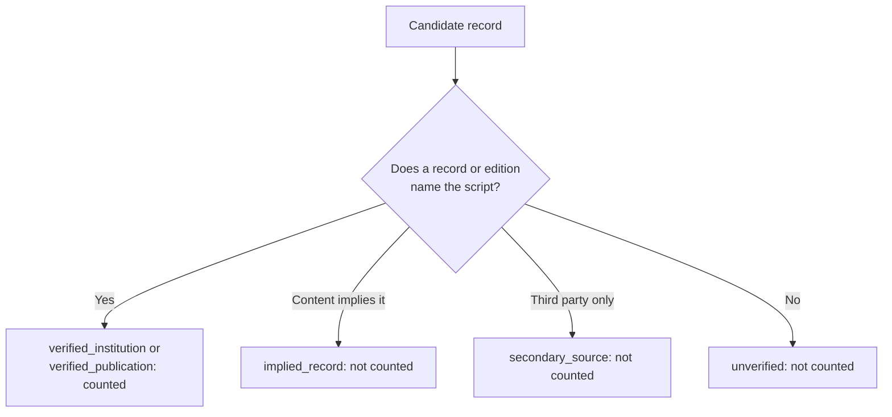

# Dataset Strategy

> **Version:** 0.6 | **Last updated:** 2026-11-01 | **Status:** Q-10 Implemented. 34 images accepted, 3 held, 2 excluded. The 40-image distribution was Approved.

Related: [MODEL_EVALUATION.md](MODEL_EVALUATION.md), [SOURCING.md](../experiments/m0_feasibility/dataset/SOURCING.md), [manifest.csv](../experiments/m0_feasibility/dataset/manifest.csv), [QUALITY_REPORT.md](../experiments/m0_feasibility/dataset/QUALITY_REPORT.md), [STAGE_C_REPORT.md](../experiments/m0_feasibility/dataset/STAGE_C_REPORT.md)

## Supported scripts

In scope: Brahmi, Kharosthi, Phoenician, Greek, Latin, and Runic. The set is built from confusable pairs, because easily separated systems would inflate accuracy.

Cuneiform and Egyptian hieroglyphs are deliberately out of scope. They test whether a model abstains instead of forcing a match.

**Brahmi boundary:** this experiment uses early Brahmi. Later Gupta-period forms and Tamil-Brahmi were not selected, which keeps the class clear.

## Dataset distribution

This dataset is a small convenience sample. It is **not representative** of worldwide historical writing systems.

| Class | Target | Accepted | Held | Excluded | Not acquired |
|---|---|---|---|---|---|
| Brahmi | 5 | **4** | 1 | 0 | 0 |
| Kharosthi | 5 | **2** | 2 | 1 | 0 |
| Phoenician | 5 | 5 | 0 | 0 | 0 |
| Greek | 5 | 4 | 0 | 0 | 1 |
| Latin | 5 | 5 | 0 | 0 | 0 |
| Runic | 5 | 4 | 0 | 1 | 0 |
| **In-scope** | **30** | **24** | **3** | **2** | **1** |
| Cuneiform | 4 | 4 | 0 | 0 | 0 |
| Egyptian hieroglyphs | 4 | 4 | 0 | 0 | 0 |
| No writing | 2 | 2 | 0 | 0 | 0 |
| **Rejection** | **10** | **10** | **0** | **0** | **0** |

The manifest has 40 development rows and 3 reserve rows. Reserve rows never enter metrics. **Kharosthi has only 2 counted images, and 3 of the 4 Brahmi images are printed plates.**

## Image sourcing

Sources are chosen in this order:

1. Institutional open-access records with an explicit per-object licence.
2. Institutional images on Wikimedia Commons, tied to an object number.
3. Plates from scholarly editions in the public domain.
4. Third-party photographs, only as reserves with `secondary_source` labels.

Metadata came from the Met Collection API, the Cleveland Open Access API, and the Wikimedia Commons API. The per-image evidence and attribution are in [SOURCING.md](../experiments/m0_feasibility/dataset/SOURCING.md).

## Ground-truth verification

**Culture does not determine script.** Met object 26.60.69 is catalogued as Roman, yet the Met says its inscription is in Greek.

A language tag alone does not identify a writing system. A language tag with a letter-for-letter edition does (ADR-032).

Each manifest row stores its evidence URL. No epigrapher has reviewed the labels.

**Known conflict:** Baums 2012 and the Met number the two Bajaur caskets the opposite way round. Met records, dimensions, and images agree, but the conflict is not independently resolved.

**Stage C gate:** a row counts only if it is also `stage_c_status=accepted`, meaning it was downloaded, viewed, and found suitable.

**Crops:** a crop is accepted only if it passes inspection and keeps the complete visible inscription. Removing a caption is not enough. Originals stay read-only in `data/images/`, and crops sit in `data/processed/`.

**Excerpts (Approved; Implemented; none accepted):** a crop that drops part of the inscription may count only as `sample_type=excerpt`, for script identification alone, with no clipped characters and no answer clues. SE010 failed the clipping check.

**Margin clearing (Approved; Implemented; Verified offline, ADR-064):** printed numbers and captions on blank paper may be filled with the surrounding paper tone, using recorded regions. No pixel on the inked impression may change. SE003 and SE004 passed and count as complete samples. SE010 stays held, because some of its numbers are printed on the impression.

## Copyright and licensing

- Licences are checked per object, because a collection-level policy does not guarantee any single object. Met 74.51.2293 has no public image, despite a search summary implying that it was open.
- Images are not committed, even where licences allow it. Git holds URLs, attribution, and SHA-256 hashes.
- CC BY images must carry attribution wherever they appear.
- All licences were re-read before download at Stage C. Wikimedia does not warrant licence accuracy.
- SE008 relies on a permission ticket that is not public, so it is held, uncounted, and not redistributable until independently verified.
- Unicode code charts must not be redistributed. See [SECURITY_AND_PRIVACY.md](SECURITY_AND_PRIVACY.md).

## Leakage prevention

| Risk | Control | Status |
|---|---|---|
| Same object appears twice | `check_rows` rejects a duplicate institution and object | Verified offline |
| Metadata reveals the label | Only re-encoded pixels are sent | Verified offline in `preprocess.py` and `images.py` |
| Single-source classes | Recorded in `leakage_risks` | Documented, not controlled |
| Printed plates in South Asian classes | 6 of 10 rows, recorded | Documented, not controlled |
| Brahmi plates and famous objects overlap | 4 of 5 rows | Documented, not controlled |
| Famous objects | `famous_object` flag, 9 of 40 rows | Flagged, with subgroup reporting Verified offline |
| Repeated edict text | Recorded | Documented, not controlled |
| Text in the image reveals the label | 6 plates print the site name. All are cropped, cleared, or uncounted | Verified offline by `test_every_captioned_plate_is_cropped_or_uncounted` |
| Near-duplicate images | Perceptual screen found none | Verified at Stage C |
| Dev images reused for evaluation | Held-out set must share no objects | Planned |
| Possible training exposure | Cannot be measured or excluded | Disclosed |

## Development versus held-out data

All 40 rows are **development** data. A separate held-out set must be collected before any final claim. It must share no objects with this set, and it stays locked until the prompts are frozen. The planned shape is in [MODEL_EVALUATION.md](MODEL_EVALUATION.md).

## Future expansion

- Close the remaining Greek gap by reading IG II² 1688, not by relaxing the rule.
- Replace printed plates with photographs in the held-out set, and find a real Brahmi inscription photograph.
- Reduce dependence on the Met, which supplies 26 of 34 counted rows.
- Add hard negatives. All five candidates were inspected at Stage C.2, and none qualifies yet. Results are in the [Stage C report](../experiments/m0_feasibility/dataset/STAGE_C_REPORT.md). Other recommendations are in the [quality report](../experiments/m0_feasibility/dataset/QUALITY_REPORT.md). None is adopted, because replacement needs approval.
- Add damaged in-scope images, scored separately.
- Reduce single-source classes.
- Seek an epigrapher's review.
- Add underrepresented regions, then the Bengali track.
- Consider Met 256256, a modern forgery of a Roman inscription, as an adversarial case.
