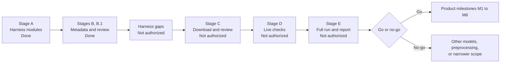

# Implementation Roadmap

> **Version:** 0.2 | **Last updated:** 2026-11-01 | **Status:** M0 in progress, Stage B.1 complete. Dates after M0 are Proposed, because the November 15 target has not been approved.

Related: [SESSION_HANDOVER.md](SESSION_HANDOVER.md), [RISKS_AND_LIMITATIONS.md](RISKS_AND_LIMITATIONS.md), [DECISIONS.md](DECISIONS.md)

## Completed

| Item | Date | Evidence |
|---|---|---|
| Architecture and solution design | 2026-11-01 | [ARCHITECTURE.md](ARCHITECTURE.md) |
| Stage A: harness modules | 2026-11-01 | 104 offline tests passed |
| Stage B: dataset metadata | 2026-11-01 | [SOURCING.md](../experiments/m0_feasibility/dataset/SOURCING.md) |
| Permanent documentation | 2026-11-01 | This set of documents |
| Stage B.1: label evidence, quality report, gates, and first commit | 2026-11-01 | [QUALITY_REPORT.md](../experiments/m0_feasibility/dataset/QUALITY_REPORT.md), 113 offline tests passed, Git history |

## Current milestone: M0 feasibility

Waiting for user review of Stage B.1.

### Gaps found in the Stage A harness

These modules exist and pass their own tests, but **they are not joined up**. All of this must be built before Stage D or E can run.

| Gap | Needed for |
|---|---|
| Command-line entry point | Any run |
| Loader for `config/models.yaml` and `config/run.yaml` | Using the frozen settings |
| Building `GoldItem` from manifest rows, filtered by `eligible_for_metrics` | Correct metrics |
| Connecting `preprocess.py` to the runner | Metadata removal |
| Image downloader with SHA-256 recording | Stage C |
| `httpx` Transport | Stage D |
| Preflight script: catalog check, canary image, structured-output check | Stage D |
| Famous-object subgroup results | Promised in METHODOLOGY.md |
| Failure analysis output | Required deliverable |
| Go/no-go section in the report | Required deliverable |
| Plate and photograph subgroup results | Recommended by the quality report |

## Upcoming tasks

| # | Task | Depends on | Acceptance criteria | Authorization |
|---|---|---|---|---|
| 1 | Review Stage B.1 | User | Next stage approved | Pending the user |
| 2 | Close the harness gaps above, offline | Task 1 | End-to-end synthetic run works from one command | **Not authorized** |
| 3 | Stage C: download and review images | Tasks 1, 2 | Hashes recorded; quality assessed; licences rechecked; conflicts resolved; gates recalculated | **Not authorized** |
| 4 | Stage D: live checks | Task 3, funded keys | Canary and structured output proven per provider | **Not authorized** |
| 5 | Stage E: full run and report | Task 4 | Report, confusion matrix, failure analysis, go/no-go | **Not authorized** |

## Go/no-go criteria

Proceed only if at least one model meets the five gates in [MODEL_EVALUATION.md](MODEL_EVALUATION.md), results are reproducible, unsupported inputs are distinguished reasonably, output validates, and the limitations are understood.

If both models fail, investigate other models, image preprocessing, and narrower coverage. Do not manipulate the dataset or criteria.

**Fallback product:** a guided identification tool, where the user answers visual questions and the collection does the matching.

## Product milestones (Proposed)

Start only after a go decision. Assumes about 3 focused hours a day.

| Milestone | Deliverable | Exit criteria |
|---|---|---|
| M1 Foundation | Workspace, contracts, intake, `ModelProvider`, CI | Failure tests pass with no key |
| M2 Knowledge | Six reviewed script records and comparisons | Validator passes; sources checked by hand |
| M3 Pipeline | Five stages and error mapping | End-to-end run with live and fixture adapters |
| M4 Interface | Upload, crop, result views, all outcomes | Each outcome demonstrated |
| M5 Evaluation | Held-out set, prompt freeze, report | Reproducible from a clean clone |
| M6 Release | Deployment, security pass, README, article, walkthrough | Fresh-machine setup succeeds |

The original dates ran from November 4 to 15. These no longer hold if M0 extends past November 3.

**Cut order if time runs short:** transcription, then the second gateway adapter, then the crop tool, then two scripts. The evaluation report and failure handling are never cut.

## Dependencies

| Dependency | Needed by | Status |
|---|---|---|
| OpenRouter key with a spending limit | Stage D | Not provided |
| Hugging Face token with purchased credits or PRO | Stage D | Not provided |
| Approval to access package repositories | Only for a clean install or new packages | Not requested for current work |
| Epigrapher review | Stronger labels | Not arranged |

## Post-MVP

1. More scripts, starting with underrepresented regions.
2. The Bengali evolution track.
3. BM25 retrieval.
4. Transcription.
5. Fine-tuning experiments, once a larger dataset exists.
