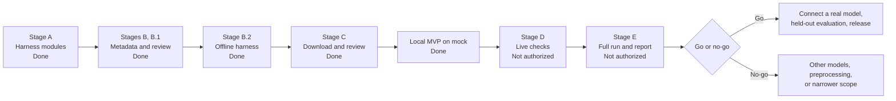

# Implementation Roadmap

> **Version:** 1.1 | **Last updated:** 2026-11-01 | **Status:** Local MVP built in demo mode. M0 model evaluation has not run. Dates after M0 are Proposed, because the November 15 target has not been approved.

**Naming:** the implementation mission used "Stage D" for model integration and "Stage E" for the backend. In this repository, **Stage D and Stage E always mean the experiment's live checks and full run. Those have not happened and are not authorized.**

Related: [SESSION_HANDOVER.md](SESSION_HANDOVER.md), [RISKS_AND_LIMITATIONS.md](RISKS_AND_LIMITATIONS.md), [DECISIONS.md](DECISIONS.md)

## Completed

| Item | Date | Evidence |
|---|---|---|
| Architecture and solution design | 2026-11-01 | [ARCHITECTURE.md](ARCHITECTURE.md) |
| Stage A: harness modules | 2026-11-01 | 104 offline tests passed |
| Stage B: dataset metadata | 2026-11-01 | [SOURCING.md](../experiments/m0_feasibility/dataset/SOURCING.md) |
| Permanent documentation | 2026-11-01 | This set of documents |
| Stage B.1: label evidence, quality report, gates, and first commit | 2026-11-01 | [QUALITY_REPORT.md](../experiments/m0_feasibility/dataset/QUALITY_REPORT.md), 113 offline tests passed, Git history |
| Stage B.2: offline harness joined, one-command synthetic run | 2026-11-01 | 196 offline tests passed. Not yet committed |
| Stage C: 39 images acquired and inspected | 2026-11-01 | [STAGE_C_REPORT.md](../experiments/m0_feasibility/dataset/STAGE_C_REPORT.md), 233 offline tests passed. Not yet committed |
| Stage C.1: crops, SE001 replacement, 32 accepted | 2026-11-01 | 288 offline tests passed. Not yet committed |
| Stage C.2: excerpt review, hard-negative inspection, research | 2026-11-01 | 322 offline tests passed. Not yet committed |
| Local MVP: API, web app, mock provider, reference collection, offline test suite | 2026-11-01 | See [SESSION_HANDOVER.md](SESSION_HANDOVER.md). Not yet committed |
| Q-10 and product verifier hardening | 2026-11-01 | ADR-064, ADR-065. 659 offline tests passed |
| M0 freeze commit | 2026-11-01 | Direct child of `5e5941d`. Not pushed |

## Current milestone: M0 feasibility

The owner decided that M0 precedes product-level real-model work (ADR-062). The 8 harness fixes required before Stage D are done, and [M0_READINESS_AND_EXECUTION_SPEC.md](M0_READINESS_AND_EXECUTION_SPEC.md) lists them, with the Proposed run. Margin clearing is applied (ADR-064), which gives 24 in-scope images. Kharosthi stays thin at 2, and rejection rests on easy negatives.

### Remaining harness gaps

The offline path is complete. Each of these belongs to a later stage, and none is authorized.

| Gap | Needed for |
|---|---|
| `httpx` transport | Implemented in `live/`, never run against a provider |
| Preflight checks with generated canaries | Implemented, with a catalog check, in `live/stage_d.py`. Not run |
| Live mode in `run.py`, using `LocalImageSource` and credentials | Stage D and E. `--live` stays refused |
| Provider-specific extras, such as thinking control, if Stage D requires them | Stage D |

## Upcoming tasks

| # | Task | Depends on | Acceptance criteria | Authorization |
|---|---|---|---|---|
| 1 | Review the MVP and Stage C.2, and decide on margin clearing | User | Decisions recorded | Done (ADR-064) |
| 2 | Apply those decisions, and recalculate gates | Task 1 | `--check` clean; gates updated | Done, 12/24 and 20/24 |
| 3 | Stage D: live checks | Preparation commit, funded keys | Canary and structured output proven per provider | **Not authorized** |
| 4 | Stage E: full run and report | Task 3 | Report, confusion matrix, failure analysis, go/no-go | **Not authorized** |
| 5 | Commit the accumulated work | User review at the end | Reviewed diff; no secrets or dataset images | Done, as the freeze commit. Not pushed |

## Go/no-go criteria

Proceed only if at least one model meets the five gates in [MODEL_EVALUATION.md](MODEL_EVALUATION.md), results are reproducible, unsupported inputs are distinguished reasonably, output validates, and the limitations are understood.

If both models fail, investigate other models, image preprocessing, and narrower coverage. Do not manipulate the dataset or criteria.

**Fallback product:** a guided identification tool, where the user answers visual questions and the collection does the matching.

## Product milestones

The mission of 2026-11-01 built M1 to M4 on a mock provider ahead of the go decision (ADR-052). M5 and M6 still depend on it.

| Milestone | Deliverable | Exit criteria |
|---|---|---|
| M1 Foundation (Implemented, except CI) | Workspace, contracts, intake, `ModelProvider`, CI | Failure tests pass with no key |
| M2 Knowledge (Implemented; no expert review) | Six reviewed script records and comparisons | Validator passes; sources checked by hand |
| M3 Pipeline (Implemented on fixtures, single call) | Five stages and error mapping | End-to-end run with live and fixture adapters |
| M4 Interface (Implemented, no crop tool) | Upload, crop, result views, all outcomes | Each outcome demonstrated |
| M5 Evaluation (Pending) | Held-out set, prompt freeze, report | Reproducible from a clean clone |
| M6 Release (Pending) | Deployment, security pass, README, article, walkthrough | Fresh-machine setup succeeds |

The original dates ran from November 4 to 15. These no longer hold if M0 extends past November 3.

**Cut order if time runs short:** transcription, then the second gateway adapter, then the crop tool, then two scripts. The evaluation report and failure handling are never cut.

## Dependencies

| Dependency | Needed by | Status |
|---|---|---|
| OpenRouter key with a spending limit | Stage D | Not provided |
| Hugging Face token with purchased credits or PRO | Stage D | Not provided |
| npm registry access | Project dependencies and security audits | Approved (ADR-053). New packages and version changes still need fresh approval |
| Other package repositories | Any use | Not approved |
| Git identity | Any commit | Confirmed by the user (ADR-061) |
| Epigrapher review | Stronger labels | Not arranged |

## Post-MVP

1. More scripts, starting with underrepresented regions.
2. The Bengali evolution track.
3. BM25 retrieval.
4. Transcription.
5. Fine-tuning experiments, once a larger dataset exists.
