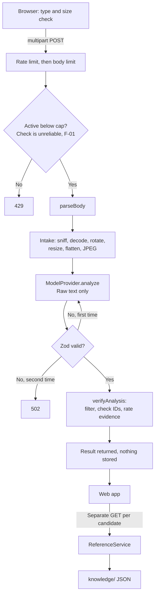

# Post-MVP Architecture and Engineering Review

> **Version:** 1.1 | **Date:** 2026-11-01 | **Scope:** the working tree on top of commit `5e5941d` | **Status:** Review complete and re-verified against current source. Every recommendation here is Proposed, and none has been applied.

Related: [SESSION_HANDOVER.md](SESSION_HANDOVER.md), [DECISIONS.md](DECISIONS.md), [SYSTEM_ARCHITECTURE.md](SYSTEM_ARCHITECTURE.md), [AI_ARCHITECTURE.md](AI_ARCHITECTURE.md), [MODEL_PROVIDER_GUIDE.md](MODEL_PROVIDER_GUIDE.md)

## Summary

**The MVP is a well-structured, well-tested shell around a capability that has never been observed.** Its strongest idea holds up in the code: sourced history and model output travel on separate paths, and the schema gives a model no field for dates, sources, or confidence. Its largest gap is equally clear: no real model has run, and the code path a real model would use differs from the one the experiment would test.

This review also corrects the MVP completion report, which said no bugs were known. **Probes confirmed 14 defects, including a concurrency cap that does not work over real sockets, plus two confirmed gaps in sourcing and upload limits.** Two of the worst were marked as working in earlier documents.

| Conclusion | Basis |
|---|---|
| Keep the separation between AI observations and stored history | Read in code, and exercised by tests |
| Fix the P0 list before real inference through the product. M0 does not need to wait for it | [Findings](#findings), [Changes in version 1.1](#changes-in-version-11) |
| Do not start with a two-stage pipeline | [ADR-054 analysis](#adr-054-single-call-versus-two-stage) |
| Decide what M0 is meant to prove about the product | F-19 |

## Update after this review

The body below is the review as written, and it is not rewritten. Later changes on 2026-11-01:

| Item | Now |
|---|---|
| F-08 | Partly addressed by ADR-065. Evidence must be visual, the Transparency page is corrected, and history mixed with a visual word can still survive |
| F-09 | Fixed: duplicates count once, and direction is compared with stored records |
| F-10 | Contradictions are refused. Whether to keep an abstention's tentative candidates is still undecided |
| F-24 | Fixed: the expert notice stays on for `no_writing`, and model text cannot switch it off |
| F-21 | Now 8 of 34 accepted images, because SE003 and SE004 joined the set |
| Git identity (ADR-061) | Resolved by the user. The Pending entries below are out of date |
| Q-10 | Applied (ADR-064). Its entries below are out of date |
| P0 items 9 and 12 | Done. Item 6 is partly done. All other P0 items are unchanged |

## Changes in version 1.1

The user's second review request listed the same areas and recorded three decisions. Version 1.0 already covered most of the list, so this version re-checks it, adds what was missing, and corrects one recommendation.

**Recommendation changed.** Version 1.0 said to fix P0 before any real inference, and placed Stage D after P0. **That was too broad.** M0 runs through the Python harness and `eval_v1`, so the product's API, adapter, and verifier are not on its path. [COMPETITION_READINESS_AUDIT.md](COMPETITION_READINESS_AUDIT.md) made this point, and it is correct. P0 now gates real inference through the product, and does not gate M0.

**Decisions recorded by the user:**

| Decision | Status | Record |
|---|---|---|
| npm registry access for project dependencies and security audits | Approved. New packages and version changes still need fresh approval | ADR-053 |
| Processing historical images through this model session | Approved. No provider, evaluation, or other service is covered | ADR-060 |
| Git author identity | Pending the user | ADR-061 |

**Added:** sections on [mock and real separation](#16-mock-and-real-provider-separation), [candidate ranking](#17-candidate-ranking), and [uncertainty and rejection](#18-uncertainty-and-rejection-handling), plus F-23 and F-24.

**Where each requested area is covered:**

| Area | Section |
|---|---|
| ADR-052 to ADR-059 | [Part 2](#part-2-adr-review) |
| Single-call versus two-stage pipeline | [ADR-054 analysis](#adr-054-single-call-versus-two-stage) |
| Frontend and backend | [1](#1-frontend-architecture), [2](#2-backend-architecture) |
| Image preprocessing | [5](#5-image-ingestion-and-preprocessing) |
| ModelProvider abstraction | [6](#6-modelprovider-abstraction) |
| Mock and real separation | [7](#7-mock-provider), [8](#8-openai-compatible-provider-adapter), [16](#16-mock-and-real-provider-separation) |
| Evidence validation | [10](#10-evidence-validation) |
| Historical reference system | [11](#11-historical-reference-service) |
| Candidate ranking | [17](#17-candidate-ranking) |
| Uncertainty and rejection | [18](#18-uncertainty-and-rejection-handling) |
| Security and privacy | [14](#14-security-controls) |
| Test architecture | [15](#15-testing-architecture) |
| Winner-quality gaps | [Part 4](#part-4-winner-quality-gap-analysis) |

## How to read the evidence

| Label | Meaning |
|---|---|
| **Observed** | A probe ran the real source and produced this result on 2026-11-01 |
| **Read** | Established by reading the code. No probe was needed, or none was run |
| **Unverified** | An assumption about model or provider behaviour. Only a real call can settle it |

**Method.** All source files, tests, prompts, ADR-052 to ADR-059, and the dataset reports were read. Probes lived in the session scratchpad, imported the real modules, and used fake providers plus synthetic images. Browser probes ran the built app in real Chrome. No model was called, no money was spent, and no source, prompt, or dataset file changed.

**Re-verification for version 1.1.** No source file changed after version 1.0. The API and contract probes were rerun on Node 24.3.0 and gave the same results, apart from timing: the F-02 run took 3,002 ms against 3,004 ms. F-01 reproduced in 10 of 10 rounds. Rerun checks on the same date: typecheck, reference validation, 179 Vitest tests, 322 pytest tests, and `--check`, all passing, with `--live` refused and `npm audit` reporting 0 vulnerabilities.

**Limits.** The 16 strings used against the history filter were chosen to break it, so they show that bypasses exist, not how often they occur. The browser probes (F-03, F-14, F-15, F-17) and the 36 browser tests were not rerun for version 1.1, because the suite rewrites tracked screenshots (F-18). The audit session last passed the full 537 on the same source. **Node 22 was not tested:** `node@22` on this machine is a link to 24.3.0, so a real test needs a Node 22 install. No model has been called, so every Unverified item below remains unverified.

## Findings

Severity reflects harm if real inference or real users were added today.

| ID | Finding | Evidence | Severity |
|---|---|---|---|
| F-01 | **The concurrency cap does not work over real sockets.** With a cap of 1 and 6 parallel 9.8 MB uploads, all 6 reached the provider in 10 of 10 rounds. The check at [app.ts:118](../apps/api/src/app.ts#L118) and the increment at [app.ts:136](../apps/api/src/app.ts#L136) sit either side of `await parseBody`. The existing test passes only because in-memory requests do not open that gap | Observed | High |
| F-02 | **The overall deadline does not bound retry waits.** A 200 ms deadline with `retry-after: 3` took 3,004 ms. [analysis.ts:84](../apps/api/src/services/analysis.ts#L84) sleeps without a cap or abort, so a large header value would hold the request for that long | Observed | High |
| F-03 | **Warnings fail open.** When `/runtime` fails, the demo banner disappears, no error appears, and upload stays available. The third-party warning at [InvestigatePage.tsx:67](../apps/web/src/pages/InvestigatePage.tsx#L67) has the same condition | Banner Observed, warning Read | High |
| F-04 | **The product adapter lacks the experiment adapter's controls.** Its request has only `model`, `temperature`, `messages`, and `response_format`. There is no `max_tokens`, `seed`, or `extra_body`, so OpenRouter's `data_collection: deny` and `require_parameters` are not sent. `finish_reason` is discarded, so a reply marked `length` was accepted. The experiment's adapter and `models.yaml` do carry these controls | Observed | High |
| F-05 | **The product prompt does not contain the output shape.** It says "matches the supplied schema", whereas the frozen prompt spells out the JSON. An endpoint that ignores `response_format` would leave the model without field names | Read. Effect Unverified | High |
| F-06 | **The schema may not suit strict mode.** It carries `$schema`, 1 `pattern`, 8 `minLength`, 8 `maxLength`, and 7 `maxItems`, and script IDs have no `enum`. A provider that refuses these would give `bad_request` on every call | Keywords Observed. Provider response Unverified | High |
| F-07 | **Repair is a re-roll.** The retry sends neither the failed reply nor the validation errors, so "do not change your assessment" refers to nothing the model can see. The harness does the same | Read | Medium |
| F-08 | **The history filter is much weaker than the interface says.** 13 of 16 adversarial strings survived, including "Mauryan empire under Ashoka", "The language is Prakrit", "The text reads ΑΘΗΝΑ", and "Translation: dedicated to Athena". [TransparencyPage.tsx:37](../apps/web/src/pages/TransparencyPage.tsx#L37) says a model "cannot" supply historical facts | Observed | High |
| F-09 | **Evidence strength can be gamed by accident.** Three identical strings rate `strong` with no expert review. A `left_to_right` observation for Phoenician, whose stored record says right to left, also rates `strong`. Nothing compares evidence with stored records | Observed | High |
| F-10 | **Cross-field checks have gaps.** `writingPresent: false` passes alongside `candidates` or `out_of_scope`. An abstention with a tentative candidate is rejected outright, which discards useful output | Observed | Medium |
| F-11 | **Script ID format can fail a whole analysis.** `Greek` and `old italic` fail validation and lead to a 502, instead of being normalized or moved to `unsupportedScriptIds` | Observed | Medium |
| F-12 | **Errors are misreported.** `auth`, `credit_exhausted`, `bad_request`, and `bad_response` all return `retryable: true`, so the interface offers a pointless retry. A timeout during body reading returns 503 rather than 504 | Observed | Medium |
| F-13 | **Provenance cannot detect some changes.** `promptSha256` is computed before script IDs are substituted, so two different prompts hash the same. `REFERENCE_VERSION` is a hard-coded constant, so editing a record does not change it. Usage from failed requests is lost | Observed | Medium |
| F-14 | **Citations can jump to the wrong record.** Results has duplicate IDs: `source-unicode-16-ch14` three times. A Kharosthi citation lands in the Brahmi panel | Observed | Medium |
| F-15 | **Results omits caveats shown elsewhere.** "From the sources" panels omit the non-specialist notice, incomplete-record warning, and limitations. Comparison shows Unicode glyphs with no "modern forms" note and no Unicode data citation | Observed | Medium |
| F-16 | **Comparison mislabels and is thin.** When both records hold a period or region, it counts as a difference with no comparison ([references.ts:146](../apps/api/src/services/references.ts#L146)), even for overlapping Brahmi and Kharosthi. Period appears this way in 6 of 15 pairs. 7 of 15 pairs have no trait comparison at all | Observed | Medium |
| F-17 | **Leaving during an analysis misfires.** The user is pulled to `/results`, and the preview is broken (`naturalWidth` 0) | Observed | Low |
| F-18 | **Test assurance has blind spots.** See [Testing architecture](#15-testing-architecture) | Read | Medium |
| F-19 | **M0 does not test the product.** The experiment uses Python, `eval_v1`, and its own schema. The product uses TypeScript, a different prompt, and different fields. No harness can evaluate the product path | Read | High |
| F-20 | **Reference sourcing is concentrated.** 28 of 32 citations go to Unicode chapters, a character-encoding standard, not an epigraphic authority. Some locators are as broad as "Chapter introduction" | Observed | Medium |
| F-21 | **Upload limits exclude the project's own data.** 6 of 32 accepted dataset images exceed 8 MB, and 21 exceed the 2,048 px edge that the model would see | Observed | Medium |
| F-22 | **Smaller issues.** See the [list below](#smaller-issues) | Read | Low |
| F-23 | **Demo results claim a live capability.** `scriptIdentification` is the literal `"available"` in the contract ([analysis.ts:92](../packages/contracts/src/analysis.ts#L92)) and in every result ([analysis.ts:112](../apps/api/src/services/analysis.ts#L112)), including simulated ones. First reported by the audit | Read | Medium |
| F-24 | **A "no writing" result never recommends expert review.** [verify.ts:85](../apps/api/src/services/verify.ts#L85) exempts it even on a poor image, although ADR-049 says appearance is not proof of no writing. Also, one strong candidate alone counts as a clear lead, so model-authored evidence can switch the notice off | Read | Medium |

### Smaller issues

- `server.ts` hard-codes `127.0.0.1`, so deployment needs a code change.
- The API runs through `tsx` in production, with no compile step.
- `useApi.ts` carries an `eslint-disable` comment, but ESLint is not installed.
- A missing `/assets/*` file returns the SPA page with status 200.
- `unhandled_error` logs only the error name, so a failure cannot be diagnosed from logs.
- The web client casts API responses to types, with no runtime validation.
- The model sees script IDs alphabetically, while the frozen prompt uses another order. Position bias is Unverified.
- Rate-limit entries can grow without a bound for a minute when `TRUST_PROXY=true`.

### Corrections to earlier statements

These statements were wrong or too strong. They are listed here, and **the documents themselves have not been changed**. Correcting them is P0 item 13, which waits for Decision 3.

| Statement | Location | Correction |
|---|---|---|
| "Remaining bugs: None known" | MVP completion report | Superseded by the findings above |
| Concurrency cap "Verified offline" | [SECURITY_AND_PRIVACY.md](SECURITY_AND_PRIVACY.md) | Only verified with in-memory requests. It fails over sockets (F-01) |
| Whole request "Stopped at `ANALYSIS_DEADLINE_MS`" | [MODEL_PROVIDER_GUIDE.md](MODEL_PROVIDER_GUIDE.md) | Not during a retry wait (F-02) |
| `data_collection: deny` configured | [SECURITY_AND_PRIVACY.md](SECURITY_AND_PRIVACY.md) | True for the experiment config only (F-04) |
| A model "cannot" supply historical facts | Transparency page | It can, in free text, labelled as unverified AI observation (F-08) |
| "Playwright found no tests, and reported success" | [CHANGELOG.md](../CHANGELOG.md) and the completion report | The false pass came from a trailing `echo` in the shell wrapper, not Playwright |
| Shared schema across API, web, and harness | ADR-012 context | The harness has a separate schema (F-19) |

## Part 1: Architecture review

The actual flow of one analysis:

History never crosses from the model path to the reference path. **The client fetches records by script ID, after the analysis.** No model sees any reference record.

In the sections below, "Alternatives" lists only what the decision records show. Where no alternative was recorded, the entry says so.

### 1. Frontend architecture

- **Implemented:** a React 18 single-page app with Vite and React Router, 8 routes under one `Layout`, one context for runtime data and the current investigation, a small `useApi` hook, and plain CSS.
- **Why:** few screens and no shared server state, so a data or state library was unnecessary. Tab-only state follows ADR-058.
- **Data flow:** `AppProvider` loads `/runtime` once. Investigate posts the file, stores the result in context, and navigates to Results, which fetches each candidate's record and the comparison.
- **Alternatives:** static hosting plus a separate API (ADR-013). No state-library alternative was recorded.
- **Limitations:** warnings depend on `/runtime` (F-03). Requests cannot be cancelled (F-17). Responses are not validated at runtime. Results cannot be saved, exported, or linked. The 304 KB bundle includes Zod because the web app imports one constant from contracts.

### 2. Backend architecture

- **Implemented:** one Hono process with routes in `app.ts`, wiring in `server.ts`, and services for intake, analysis, verification, and references. It is stateless, synchronous, and bound to loopback.
- **Why:** ADR-006 says a short request needs no queue or database. Dependencies are passed in, so tests can replace the provider.
- **Data flow:** middleware sets a request ID and headers, a route validates, a service does the work, and `onError` maps errors into one envelope.
- **Alternatives:** background jobs or streaming (ADR-006), and a Workers runtime (ADR-013).
- **Limitations:** no progress reporting, and a slow model holds the connection. `app.ts` mixes routing with concurrency logic, which is where F-01 lives. Logs hold too little to diagnose an unexpected failure.

### 3. Monorepo and workspace design

- **Implemented:** npm workspaces for `packages/contracts`, `apps/api`, and `apps/web`. Contracts are consumed as TypeScript source, and `tsx` runs the API.
- **Why:** one schema set with no build step for contracts (ADR-012).
- **Data flow:** a schema change reaches both apps at typecheck. `scripts/test-all.mjs` runs typecheck, reference validation, unit tests, browser tests, and pytest in order.
- **Alternatives:** separate repositories, or duplicated types (ADR-012).
- **Limitations:** the Python harness is outside this arrangement (F-19). There is no linter or CI. Only Node 24.3.0 has been exercised, although the stated minimum is 22.12.

### 4. Shared contracts and validation

- **Implemented:** Zod schemas for model output, results, reference records, and API types. `z.strictObject` rejects extra keys. `superRefine` adds cross-field rules, which cannot be expressed in JSON Schema.
- **Why:** ADR-008 validates locally, whatever a provider promises. Leaving out fields for history is a stronger guarantee than filtering for it.
- **Data flow:** `z.toJSONSchema` produces the schema sent to the provider. The same Zod schema checks the reply. Reference data is parsed at startup.
- **Alternatives:** trusting strict structured output (ADR-008).
- **Limitations:** the schema is structural, and free text can still say anything (F-08). Rules have gaps (F-10). It may not suit provider strict modes (F-06). Script IDs are a regex rather than a generated enum (F-11).

### 5. Image ingestion and preprocessing

- **Implemented:** `processUpload` sniffs magic bytes, then `sharp` applies a pixel limit, rejects multi-page files, applies orientation, fits within 2,048 px, flattens onto white, and writes JPEG at quality 92. Everything stays in memory.
- **Why:** defeats polyglots and metadata leakage, and matches the experiment's preprocessing values.
- **Data flow:** bytes go from the multipart body through checks to a re-encoded buffer, which reaches the provider. The original stays in the browser for preview.
- **Alternatives:** no alternative was recorded. ADR-058 records saved investigations as the alternative to in-memory handling.
- **Limitations:** an 8 MB limit and 2,048 px edge exclude or shrink much of the dataset (F-21). Fine strokes in long inscriptions may be lost, which is Unverified. Decoding memory near the 120 MP limit was not measured, and F-01 removes the cap meant to contain it.

### 6. ModelProvider abstraction

- **Implemented:** one interface with `analyze` plus metadata. It returns raw text, and failures become a typed `ProviderError`.
- **Why:** every provider faces the same validation, and retries stay outside providers (ADR-007).
- **Data flow:** `createProvider` selects one provider from configuration. `AnalysisService` is the only caller.
- **Alternatives:** direct provider SDKs, or a large framework (ADR-007).
- **Limitations:** `demoScenario` leaks a mock concern into the shared request. There is no way to pass `max_tokens`, seed, or provider options (F-04).

### 7. Mock provider

- **Implemented:** five JSON fixtures, plus a simulated failure. A scenario is chosen by name, or from the first byte of the image's SHA-256.
- **Why:** offline demos and deterministic tests with no key (ADR-052). Fixtures are raw model output, so they pass through the real validation and verification.
- **Data flow:** it never decodes the image, and only hashes it. Text says "Simulated observation", and results carry `simulated: true`.
- **Alternatives:** recorded model responses (requirement F9), which do not exist because no model has run.
- **Limitations:** fixtures were written to pass. They cannot show how real output behaves. In automatic mode, an unrelated photo can be named as a script, with real reference records beneath it. The labels are clear, but the page still looks like a finding.

### 8. OpenAI-compatible provider adapter

- **Implemented:** `fetch` to `/chat/completions` with a base64 image, a strict JSON-schema `response_format`, and temperature 0. HTTP statuses map to error kinds, and provider error bodies are discarded.
- **Why:** one adapter can serve many gateways by configuration.
- **Data flow:** request signal, POST, status mapping, JSON parsing, then content and usage returned as text.
- **Alternatives:** the experiment adapter is a separate Python implementation, with a richer request.
- **Limitations:** **it has only met a fake `fetch`.** See F-04, F-05, F-06, and F-12. Truncated output has no specific handling, because `finish_reason` is dropped. Any reasoning text in `content` would fail parsing, which is Unverified for the chosen models.

### 9. Analysis pipeline

- **Implemented:** one provider call, then Zod, then verification. There is one repair attempt and `MODEL_MAX_RETRIES` provider retries, under per-attempt and overall timeouts. Provenance is attached to success.
- **Why:** the simplest design that can be measured. See ADR-054.
- **Data flow:** the loop can make up to 3 calls with default settings. A probe confirmed 3 calls for bad output, an outage, then bad output.
- **Alternatives:** Observe then Hypothesize (ADR-002).
- **Limitations:** F-02, F-07, and F-13. A failed request reports no usage, although it may have been billed.

### 10. Evidence validation

- **Implemented:** `verifyAnalysis` removes statements that match 5 patterns, drops unknown scripts and candidates left with no evidence, renumbers ranks, computes strength, and sets `recommendExpertReview`.
- **Why:** a deterministic backstop that needs no model. Removal rather than rewriting avoids guessing.
- **Data flow:** it runs after Zod. Removals are counted and shown to the user.
- **Alternatives:** a model-based verifier was not recorded. Python's scanner reports hits and removes nothing, which suits evaluation.
- **Limitations:** **this validates form, not truth.** It has no link to the image or the reference collection. Language, transcription, and translation text pass through (F-08). See F-09 for strength.

### 11. Historical reference service

- **Implemented:** 6 JSON records and 8 sources. Each claim has source IDs and a locator. Zod plus `checkCollection` run at startup, and any problem stops the server. Unknown fields stay `null`.
- **Why:** ADR-001 and ADR-055. Adding a record needs no code change.
- **Data flow:** read at startup, held in memory, served by ID with only the sources it cites.
- **Alternatives:** model-written context checked afterward (ADR-001), a vector store (ADR-003), and YAML (ADR-055).
- **Limitations:** claims are paraphrases, with no stored quotation to recheck. Sourcing is narrow (F-20). No expert has reviewed it. Citations can misdirect (F-14), and caveats drop out on Results (F-15). The version is not derived from content (F-13).

### 12. Candidate comparison service

- **Implemented:** `compare` matches 3 trait keys by exact stored value, and adds period and region. Missing data becomes `missingEvidence`. A descent caveat always applies.
- **Why:** it can only show stored, sourced values, which rules out invented similarities.
- **Data flow:** two IDs in, claims and sources out. No model is involved.
- **Alternatives:** none recorded.
- **Limitations:** F-16. Of 15 pairs, 3 share a trait, 5 differ on one, and 7 have neither. Missing evidence also omits a trait that neither script has. **It compares records, not what a researcher needs to tell two scripts apart**, because no diagnostic visual features are stored.

### 13. Error handling and retries

- **Implemented:** 11 typed codes with fixed status and retryability, one envelope, `retry-after` support, and generic text for unknown errors.
- **Why:** clients can act on a stable code, and no provider detail leaks.
- **Data flow:** `ProviderError`, then `toAppError`, then `AppError`, then `onError`, then an interface notice with an optional retry.
- **Alternatives:** none recorded.
- **Limitations:** F-02 and F-12. A retry after a timeout may repeat a billed request. The request ID is not shown to users, which makes a report hard to trace.

### 14. Security controls

- **Implemented:** loopback binding, two-setting inference, content sniffing, re-encoding, body and pixel limits, a rate limit, a strict CSP, a log key filter, discarded provider bodies, and text-only rendering.
- **Why:** the threats are hostile uploads, key exposure, and unintended image transmission.
- **Data flow:** see [SECURITY_AND_PRIVACY.md](SECURITY_AND_PRIVACY.md).
- **Alternatives:** recorded in ADR-056, ADR-058, and ADR-059.
- **Limitations:** F-01, F-03, and F-04, plus the deployment gaps already documented. Taking the leftmost `x-forwarded-for` value is safe only behind a proxy that overwrites it.

### 15. Testing architecture

- **Implemented:** Vitest for contracts, API, and web, Playwright in real Chrome at two sizes, pytest for the harness, and axe in jsdom and Chrome. One command runs everything.
- **Why:** offline behaviour can be proven cheaply, and fault paths can be injected.
- **Data flow:** tests build the app with injected providers. Browser tests use the mock through a real server.
- **Alternatives:** none recorded. Playwright uses installed Chrome to avoid a browser download.
- **Limitations (F-18):**
  - In-memory requests hid F-01, so concurrency needs a real-socket test.
  - Every browser test uses a healthy `/runtime`, which hid F-03.
  - The adapter's test checks that a schema is sent, not that a provider accepts it.
  - Without `.venv`, `npm test` skips 322 tests and still exits 0.
  - Running `npm test` rewrites `docs/screenshots/`.
  - Axe does not report duplicate IDs in this setup, which hid F-14.
  - There is no contract test built on recorded real output.

**537 passing tests show that this code does what its tests describe. They show nothing about any model.**

### 16. Mock and real provider separation

- **Implemented:** `createProvider` picks exactly one provider ([providers/index.ts:7](../apps/api/src/providers/index.ts#L7)). Startup refuses a non-mock provider without `ALLOW_EXTERNAL_INFERENCE=true` and the base URL, model ID, and key ([config.ts:54](../apps/api/src/config.ts#L54)). `simulated` is a fixed property of each provider class, and the result copies it from the provider, not from model output. Demo scenarios are honoured only when the provider is simulated ([app.ts:129](../apps/api/src/app.ts#L129)).
- **Why:** ADR-056. A mistaken setting should not send an image or spend money, and a fixture should never pass as inference.
- **Data flow:** both providers return raw text through the same interface, then share validation and verification. Only the `simulated` value differs.
- **Alternatives:** one setting, or inferring intent from a key (ADR-056).
- **Limitations:** the separation is sound in the server. It weakens at the edges: the demo label depends on `/runtime` (F-03), results say identification is available in demo mode (F-23), and `demoScenario` sits in the shared request type. Sharing the path means the mock proves the pipeline, not the adapter (F-04, F-05, F-06). The real path has met only a fake `fetch`.

### 17. Candidate ranking

- **Implemented:** the model orders up to 3 candidates. The schema requires ranks to start at 1 with no gaps. `verifyAnalysis` drops unsupported scripts and candidates left with no evidence, then renumbers. No code changes the model's order.
- **Why:** the system has no independent score, and sorting by computed strength would present an evidence count as a likelihood.
- **Data flow:** model ranks, schema check, removals, renumbering, then strength per candidate. Rank and strength are shown side by side.
- **Alternatives:** none recorded.
- **Limitations:** rank 1 can be `weak` above a `strong` rank 2. That disagreement keeps the expert notice on, but it is not explained to the user. Whether model order reflects likelihood is Unverified. Top-1 accuracy and top-3 recall are gates in M0, and the product's own ranking has no measurement path (F-19).

### 18. Uncertainty and rejection handling

- **Implemented:** four statuses: `candidates`, `insufficient_evidence`, `out_of_scope`, and `no_writing`. If verification removes every candidate, status becomes `out_of_scope` when an unsupported script was named, and otherwise `insufficient_evidence`. Strength and `recommendExpertReview` are computed by code, with no percentage anywhere.
- **Why:** ADR-005 and ADR-057. Abstaining is a valid answer, and an uncalibrated number would mislead.
- **Data flow:** the model chooses a status, the schema applies cross-field rules, and verification can only downgrade `candidates`. It never overrides an abstention.
- **Alternatives:** model confidence percentages (ADR-057).
- **Limitations:** **rejection is entirely the model's choice.** `REJECTION_CLASSES` at [app.ts:15](../apps/api/src/app.ts#L15) is display text, and no code detects cuneiform, hieroglyphs, or blank surfaces. Contradictory combinations pass (F-10), and "no writing" skips expert review (F-24). Whether any of these signals tracks being correct is Unverified until ADR-005's ordering check runs on real results. The M0 rejection gate rests on 10 images, including 2 easy negatives.

## Part 2: ADR review

### ADR-052: Build the MVP on a mock before go/no-go

| Aspect | Assessment |
|---|---|
| Original decision | Build a complete local MVP on a mock, with M0 still governing any real launch |
| Current implementation | Matches, and simulated results are labelled |
| Reasoning | The user directed it. It delivers a runnable system and a reference collection regardless of M0 |
| Advantages | Pipeline, interface, and failure paths exist early. The reference collection survives a no-go |
| Disadvantages | Effort went into a product whose central capability is unproven |
| Risks | Polish may be mistaken for evidence |
| **Recommendation** | **Stays Approved.** Record one explicit exit rule: no accuracy or capability claim before M0 results |

### ADR-053: npm registry for the named stack, Node 22.12

| Aspect | Assessment |
|---|---|
| Original decision | Treat the named stack as authorization for it and its test tools, and upgrade vulnerable packages |
| Current implementation | Matches. `npm audit` showed 0 vulnerabilities on 2026-11-01 |
| Reasoning | The stack cannot be installed otherwise, and the vulnerabilities were real |
| Advantages | Current, audited dependencies |
| Disadvantages | Node floor rises to 22.12. An audit result goes out of date |
| Risks | The floor itself is untested, because all runs used 24.3.0 and this machine has no real Node 22 |
| **Recommendation** | **npm access: Approved by the user on 2026-11-01**, for project dependencies and security audits, with new packages and version changes still needing fresh approval. **Node 22.12 minimum: approve after a clean-install test on Node 22** |

### ADR-054: One structured call in the MVP

| Aspect | Assessment |
|---|---|
| Original decision | One call, then deterministic verification. ADR-002 stays open |
| Current implementation | Matches |
| Reasoning | Two stages cannot be justified without measurement, and M0's frozen protocol is single-call |
| Advantages | Simplest to build and debug. Comparable with `eval_v1`. Lower cost and latency |
| Disadvantages | Hypotheses may shape observations. Evidence may be written to justify an answer already chosen |
| Risks | Evidence is not independent, so strength may reflect the model's confidence in disguise |
| **Recommendation** | **Remain Proposed**, reworded as the measured baseline. See below |

#### ADR-054: single call versus two stage

The word "two-stage" covers three different designs, and the current build is already one of them.

| | **A. Current** | **B. Two-stage as requested** | **C. ADR-002** |
|---|---|---|---|
| Stage 1 | Vision call: observations and candidates | Vision call: script classification | Vision call: observations only |
| Stage 2 | Deterministic record lookup | Evidence-grounded historical enrichment | Second call forms hypotheses from observations |
| Model calls | 1 | 2 if Stage 2 uses a model, otherwise 1 | 2 |
| Who presents history | Stored records | Depends on Stage 2 | Stored records |

**Design A already separates classification from enrichment.** Its second stage is a deterministic lookup. So the real question for B is whether a model should take part in enrichment, and in which of two ways:

| Question | B1: model writes prose from retrieved records | B2: model only selects stored claim IDs | A: deterministic lookup |
|---|---|---|---|
| Can it introduce unsupported history? | Yes. Paraphrase can drift, even from good sources | Not as new text, since only stored text is shown | No |
| Conflicts with ADR-001? | **Yes.** It needs that decision reversed | No | No |
| Needs a checker? | Yes, claim-level entailment, which is itself uncertain | ID validity only | No |
| User value | More readable, tailored explanation | Shows the most relevant claims | Shows the whole record |
| Value with today's collection | Low: 3 to 7 claims per script | Low: there is little to select from | Adequate |
| Extra cost and latency | Added call, text only | Added call, text only | None |
| Failure modes | Fabrication, omission, added latency | Poor selection, omission | None beyond record gaps |

The comparison of A and C on the vision task:

| | A: one vision call | C: observe, then hypothesize |
|---|---|---|
| Independence of observations | None. Written with the answer in mind | Better if the second call sees only observations, or observations plus reference cards |
| Risk of memorized recognition | The answer can drive the evidence | Reduced, but the observation model may still recognize the object |
| Can use reference records in reasoning | Only by bloating one prompt | Naturally, at the second call |
| Early exit on no writing | Not available | Available, saving a call |
| Information loss | None | Hypothesis without the image relies on a text description, and may lose shape detail |
| Cost and latency | Baseline. Planning estimate of about $0.0012 per call for Model A | About double by ADR-002's estimate. **Not measured** |
| Failure surface | One output to validate | Two, plus a mismatch between them |
| Comparable with M0 | Yes | No. It needs a new, documented experiment |

**Unverified:** that either design improves accuracy, rejection, or evidence quality for these scripts. No data exists either way.

**Recommendation.** Keep A as the measured baseline. Run M0 first. If rejection or evidence quality fails, test C as a new documented experiment on development data only, which is what ADR-002 already requires. Do not build B1, because it reverses the project's main safety decision for little gain at this collection size. Consider B2 only if a much larger collection makes selection useful.

### ADR-055: Validated JSON, with scripts as data

| Aspect | Assessment |
|---|---|
| Original decision | One JSON file per script, each claim sourced and located, gaps left `null` |
| Current implementation | Matches, and startup refuses a bad collection |
| Reasoning | Reviewable in Git, no parser dependency, no database |
| Advantages | Citation integrity is checked mechanically. A new script needs no code |
| Disadvantages | Hand-curated, and traits are a closed list of 3 keys |
| Risks | Unicode dominates sourcing (F-20). Version is a hand-set constant (F-13). Validation proves a citation exists, not that it supports the claim |
| **Recommendation** | **Approve the format.** Treat source diversity and version derivation as separate follow-ups |

### ADR-056: Two settings for external inference

| Aspect | Assessment |
|---|---|
| Original decision | Mock by default. A real provider needs `MODEL_PROVIDER` and `ALLOW_EXTERNAL_INFERENCE=true` |
| Current implementation | Matches for startup. Setting only the switch leaves the mock in place |
| Reasoning | A mistaken setting should not send images to a third party or spend money |
| Advantages | Safe by default, and easy to audit |
| Disadvantages | One more setting |
| Risks | It controls whether data leaves, not how it is handled. Data-routing options are not sent (F-04), and the warning fails open (F-03) |
| **Recommendation** | **Approve**, and require F-03 and F-04 to be fixed before enabling it |

### ADR-057: Evidence strength by rule, no numeric confidence

| Aspect | Assessment |
|---|---|
| Original decision | Compute strong, moderate, or weak from counts and quality. Show no percentage |
| Current implementation | Matches. Quality is the model's own report |
| Reasoning | Model percentages are not calibrated, and users read them as probabilities |
| Advantages | Deterministic, simple, and no false precision |
| Disadvantages | Measures quantity, not validity. Inputs are all model-authored |
| Risks | "Strong evidence" reads as a verdict. Duplicate items earn it (F-09). A model that writes more looks stronger. It can also suppress the expert-review notice |
| **Recommendation** | **Approve the no-percentage principle. Reconsider the rule.** At minimum, deduplicate, cross-check stored traits, and run the ordering check ADR-005 requires. Consider renaming it, for example "evidence listed", until that check passes |

### ADR-058: In-memory uploads, nothing stored

| Aspect | Assessment |
|---|---|
| Original decision | One request in memory, no temporary files or history, results in the tab |
| Current implementation | Matches for the server, and reload loses results |
| Reasoning | Uploads may be sensitive, and retention brings obligations |
| Advantages | Little data to protect, and no deletion duties |
| Disadvantages | Researchers cannot save, export, or compare past results |
| Risks | Memory use without a working cap (F-01). If a third-party provider is enabled, "not stored" is true of ScriptEcho only |
| **Recommendation** | **Approve**, with client-side export as the only addition worth considering (P2) |

### ADR-059: Ignore forwarded addresses by default

| Aspect | Assessment |
|---|---|
| Original decision | Use `x-forwarded-for` only when `TRUST_PROXY=true`. Otherwise use one shared bucket |
| Current implementation | Matches, and is tested |
| Reasoning | The header can be forged |
| Advantages | The bypass is closed for the supported loopback mode |
| Disadvantages | All clients share one limit |
| Risks | Leftmost-value parsing is safe only behind a proxy that overwrites the header, and many append |
| **Recommendation** | **Approve for local use.** Revisit proxy parsing only if deployment is approved |

### ADR-060 and ADR-061: decisions recorded after version 1.0

- **ADR-060 (Approved):** historical images may be processed through this model session. It is not Stage D, approves no provider, and produces no evaluation result. It does not lift the SE002 or SE008 holds.
- **ADR-061 (Pending the user):** Git identity is unverified. No configuration changes or commits until the user confirms it.

## Part 3: AI engineering review

| Topic | Implemented behaviour | Unverified assumption |
|---|---|---|
| **How a script is identified** | One image goes to one model, with a prompt and the list of supported IDs. No reference images, sign lists, or examples are provided | That a general vision model can recognize these scripts from shapes alone, not from object style or memorized images. M0 exists to test this |
| **Candidate ranking** | The model orders up to 3 candidates. Code checks ranks, removes unsupported scripts, and renumbers. It never reorders, so rank 1 can be `weak` above a `strong` rank 2 | That model order reflects likelihood |
| **Visual evidence** | Free-text lists, up to 6 per candidate and up to 12 in an observation list, labelled as AI observation | That the text describes what is really in the image, rather than a plausible textbook feature of the chosen script |
| **Contradictory evidence** | The model may list it. Code only counts it: contradicting items at least equal to supporting items means `weak`. Direction is not checked against stored records (F-09) | That a model will volunteer evidence against its own answer |
| **Uncertainty** | Three kinds: abstention status, computed strength, and the expert-review notice. There are no probabilities | That abstention and strength track being correct. ADR-005's ordering check has not run |
| **Out-of-scope detection** | The model's own choice among four statuses, given a closed list. `REJECTION_CLASSES` is display text, and no code detects cuneiform or hieroglyphs. An unsupported ID is moved aside | That a model told about six scripts will decline, instead of forcing a match. The 7/10 gate tests this, using 2 easy negatives in no-writing |
| **Malformed output** | Zod rejects it, with no fence stripping. One re-roll follows, then a 502. Verified with fakes | That real models produce parseable output with an image, and how often. Thinking text and truncation are untested |
| **Preventing fabricated history** | Four layers. The schema has no history field. Stored records are the only displayed source of history. A pattern filter removes some free text. Interface labels mark all model text as unverified | That the model obeys the prompt. The filter does not guarantee this (F-08) |

**What is actually guaranteed.** Every sourced panel shows only stored text. A citation in that panel always resolves to a stored source. No code path can place model text there, and no percentage field exists. **What is not guaranteed:** that a model's text is free of history, language, or transcription claims, or that its evidence is true.

### What works only because of mock fixtures

| Behaviour | Why it depends on fixtures |
|---|---|
| Output validates first time | Fixtures were written to fit the schema |
| Evidence is neatly visual | Hand-written, with no history to filter |
| Removed-statement count stays 0 | Nothing is ever filtered in demo mode |
| Latency is near zero | No real inference, so the interface's long-wait behaviour is unexercised |
| Token and cost rows | Always "Not reported" in demo mode |
| Strength badges vary sensibly | Evidence counts were chosen by hand |
| Status distribution | Automatic mode chooses by hash, not by image |
| Abstention looks reliable | A fixture abstains on request. This says nothing about a model |

## Part 4: Winner-quality gap analysis

The project is not eligible for Hacktoberfest ([PROJECT_OVERVIEW.md](PROJECT_OVERVIEW.md)), so this is a quality bar only. Ratings are **Strong**, **Partial**, or **Missing**.

| Area | Status | Repository evidence | Main gap |
|---|---|---|---|
| Real open-weight AI integration | **Missing** | `openaiCompatible.ts` has met only a fake `fetch`. [MODEL_COMPARISON.md](MODEL_COMPARISON.md) marks image input and structured output as not proven | No real inference has ever run (F-04, F-05, F-06) |
| Evidence-grounded outputs | **Partial** | History is grounded through `knowledge/`. Visual evidence has no grounding in `verify.ts` | Evidence is not tied to the image or stored traits (F-09) |
| Reproducible evaluation | **Partial** | Harness, fixed gates, and frozen prompt, with 322 offline tests | No results, and the product path is not covered (F-19) |
| Historical source integrity | **Partial** | Sourced claims, locators, `null` gaps, and 32 of 32 citations resolving | 28 of 32 citations are Unicode, and no expert review (F-20) |
| Responsible AI | **Partial** | Demo labels, no percentages, separated capabilities, abstention, and Transparency page | Overclaim (F-08), and warnings fail open (F-03) |
| Research usability | **Partial** | Citations, comparison, and provenance display | No export or citation output, thin comparison (F-16), upload limits (F-21) |
| User experience | **Strong** | Responsive, keyboard tested, and axe clean in Chrome | Long waits untested. No screen-reader test. Edge bugs F-14, F-17 |
| Demo quality | **Partial** | Stable offline demo with visible scenarios and screenshots | It shows interface behaviour, and no real AI at all |
| Technical documentation | **Strong** | README, API, setup, testing, provider guide, and 61 ADRs | [Corrections listed above](#corrections-to-earlier-statements) are outstanding |
| Security and privacy | **Partial** | [SECURITY_AND_PRIVACY.md](SECURITY_AND_PRIVACY.md) controls, and 0 audit findings on 2026-11-01 | F-01, F-03, and F-04, and it is local-only by design |

**The biggest single gap is real inference.** A strong entry would show one model on labelled images, with honest failures. Everything else is supporting work.

## Part 5: Recommendations

### P0: correctness and blocking issues

Do these before any real inference through the product. They do not gate M0, which uses the Python harness. All are offline, and all need approval because most change source.

| # | Work | Findings |
|---|---|---|
| 1 | Claim a concurrency slot before parsing the body, and add a real-socket test | F-01 |
| 2 | Cap `retry-after` and make waits abort at the deadline | F-02 |
| 3 | Make warnings fail closed: while `/runtime` is unknown, show a notice and block upload, and test that state | F-03 |
| 4 | Bring the product adapter to parity: `max_tokens`, seed, configurable provider options, and `finish_reason` | F-04 |
| 5 | Put the output shape in the product prompt as a new version, and generate script IDs as an enum in the schema | F-05, F-06, F-11 |
| 6 | Add missing cross-field rules, decide how abstentions with tentative candidates are treated, keep the expert notice on for "no writing", and stop reporting identification as available in demo mode | F-10, F-23, F-24 |
| 7 | Mark only temporary failures as retryable, and map body-read timeouts correctly | F-12 |
| 8 | Hash the prompt as sent, and derive the reference version from content | F-13 |
| 9 | Deduplicate evidence, and add a deterministic direction check against stored records | F-09 |
| 10 | Make citation anchors unique per panel, and carry caveats onto Results and comparison | F-14, F-15 |
| 11 | Stop classing period and region as differences by default | F-16 |
| 12 | Replace "cannot" on the Transparency page with what the filter really does | F-08 |
| 13 | Correct the [listed documents](#corrections-to-earlier-statements) | All |
| 14 | Report skipped suites as not passed, and stop tests rewriting tracked screenshots | F-18 |

### P1: real model evaluation

Needs user approval for spending and for sending images to third parties. The session approval in ADR-060 does not cover this.

1. Decide Q-10 (margin clearing), because it changes the Brahmi and Kharosthi counts.
2. Read the DeepInfra and Hugging Face data policies, which are still unread.
3. Build the harness's live path, which does not exist yet: `httpx` transport, preflight script, and live mode. Then run experiment Stage D preflight: one canary image per provider, then a structured-output check.
4. Run Stage E on `eval_v1`, with the gates unchanged.
5. Save real outputs from approved runs as contract fixtures for the TypeScript pipeline. Check licences first, and do not reuse them as evaluation data.
6. Run ADR-005's ordering check, which needs real results.
7. Decide how the product path gets evaluated (F-19). This may be a documented second experiment over the same frozen manifest.

### P2: research-quality improvements

1. Test design C against A as a new documented experiment, only if M0 shows a need.
2. Build a held-out set, sharing no objects with development data, before any public performance claim.
3. Arrange an epigrapher's review of records and labels.
4. Broaden sources beyond Unicode, and tighten locators to page or section.
5. Add sourced, diagnostic visual features as traits, so comparison serves identification.
6. Add harder negatives once they qualify, and reduce dependence on the Met.
7. Test higher resolution or a tiling approach, if M0 errors point to lost strokes (F-21).
8. Add a client-side JSON or citation export.

### P3: optional features

Only after the above, and only if still wanted:

- A crop tool.
- Saved investigations, on the user's own device.
- Transcription for Latin and Greek, gated on measured character error rate (ADR-010).
- Selecting stored claims with a model (design B2), if the collection grows a lot.
- Public deployment, after closing the documented gaps.
- More scripts, and the Bengali track.

### Not recommended

| Do not add | Why |
|---|---|
| Vector database or embeddings | Six records fit in a prompt, and ADR-003's trigger has not been reached |
| Agents or an agent framework | The task is one classification plus a lookup, and agents would add non-determinism |
| Model-written history (B1) | It reverses ADR-001 for little gain |
| Job queue or microservices | One stateless process meets ADR-006, and no latency data argues otherwise |
| Application database | ADR-058 deliberately stores nothing |
| Fine-tuning | The dataset is far too small (ADR-009) |
| Authentication, for local use | It belongs to a deployment decision |
| A second provider abstraction | One interface is enough. Parity is the problem |

## Decisions required

These are the five most important technical decisions. Recommendations are Proposed.

| # | Decision | Recommendation |
|---|---|---|
| 1 | **Pipeline (ADR-054):** keep one vision call plus deterministic lookup as the baseline? | Yes. Test design C later only if M0 justifies it, and rule out model-written history |
| 2 | **Evaluation target (F-19):** does M0 test only the frozen experiment path, or must the product path be evaluated too? | Run frozen M0 first, then evaluate the product as a second documented experiment |
| 3 | **P0 correction stage:** approve source changes for the P0 list? | Yes, as the gate for real inference through the product. It does not need to come before M0 |
| 4 | **Stage D preflight:** approve providers, a spending limit, sending images to third parties, and whether Q-10 comes first? | Yes, after the unread data policies are read and Q-10 is decided. ADR-060 does not cover this |
| 5 | **Evidence strength (ADR-057):** redesign the rule and label, or hide it until validated? | Keep no percentages, fix duplicates and contradictions, and rename it until the ordering check passes |

**Update:** the owner has settled the order: M0 runs before the P0 list (ADR-062). The harness has its own fixes, in [M0_READINESS_AND_EXECUTION_SPEC.md](M0_READINESS_AND_EXECUTION_SPEC.md).

**Also pending, and separate from these five:** the user must confirm the Git identity (ADR-061) before any commit, including the audit's GC-0.
