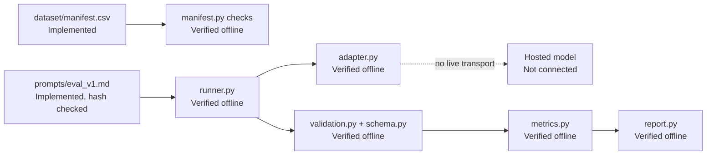
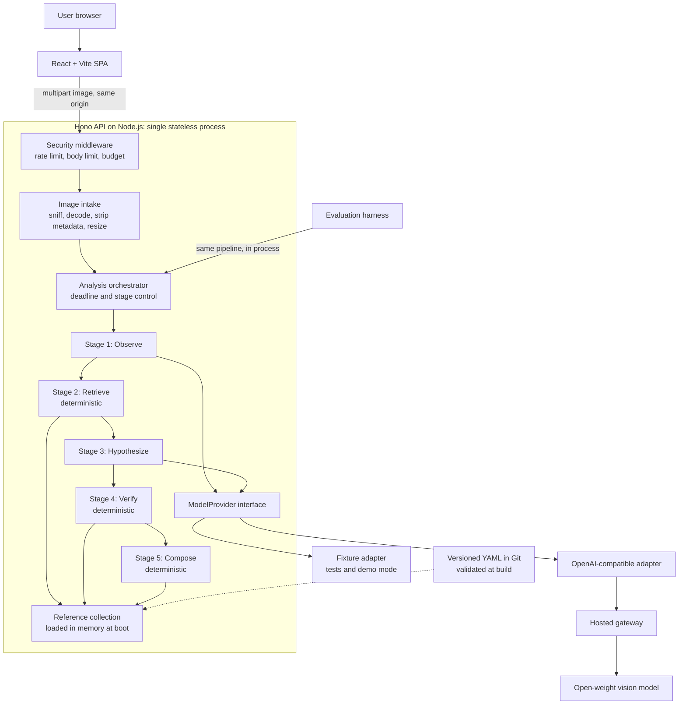
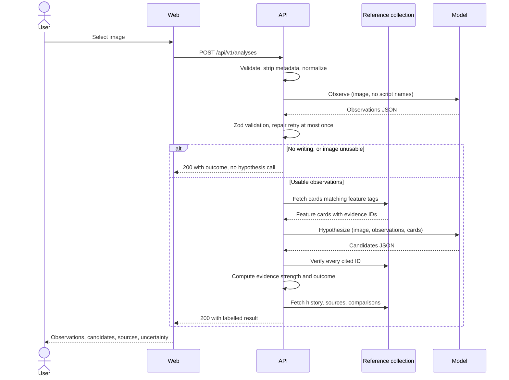

# System Architecture

> **Version:** 0.1 | **Last updated:** 2026-11-01 | **Status:** Proposed. **Nothing in this document is implemented.** The only code in the repository is the Python experiment harness described below.

Related: [AI_ARCHITECTURE.md](AI_ARCHITECTURE.md), [SECURITY_AND_PRIVACY.md](SECURITY_AND_PRIVACY.md), [DECISIONS.md](DECISIONS.md)

This document is the maintained version of the design. [ARCHITECTURE.md](ARCHITECTURE.md) is the frozen original.

## What exists today



Each module works in isolation against synthetic data. They are **not yet joined by a runnable entry point**. See the gaps in [IMPLEMENTATION_ROADMAP.md](IMPLEMENTATION_ROADMAP.md).

## Technology decisions

| Layer | Choice | Status |
|---|---|---|
| Experiment harness | Python 3.12, pydantic, pytest | Implemented |
| Frontend | React, TypeScript, Vite | Proposed |
| Backend | Node.js, Hono | Proposed |
| Validation | Zod | Proposed |
| Testing | Vitest | Proposed |
| Model access | OpenAI-compatible gateway behind `ModelProvider` | Proposed for the product |
| Historical knowledge | Versioned YAML in Git, no database | Proposed |
| Deployment | One Render service | Proposed |

Reasons and alternatives are in [DECISIONS.md](DECISIONS.md).

## Planned system architecture



Only two of the five stages call a model, and only those two can be wrong in an interesting way. The deterministic stages around them are what make the output trustworthy.

## Component responsibilities and data flow

| Component | Owns | Must not do |
|---|---|---|
| React SPA | Upload, crop, staged progress, visual separation of evidence types | Hold keys, call the model, or reinterpret results |
| Security middleware | Rate limits, body limits, global daily budget, security headers | Contain domain logic |
| Image intake | Content sniffing, safe decode, EXIF removal, resizing, re-encoding | Write to disk or log image bytes |
| Orchestrator | Stage order, shared deadline, retry policy, degraded outcomes | Know any provider's request format |
| Observe stage | Image description with no script names available | See the reference collection |
| Retrieve stage | Selecting records using observation tags | Call a model |
| Hypothesize stage | Ranked candidates that cite record IDs | Emit URLs, dates, or free-form history |
| Verify stage | Reject unknown IDs, recompute evidence strength, decide outcome | Repair content by guessing |
| Compose stage | Build the response from verified IDs and collection text | Generate prose |
| `ModelProvider` | One vendor-neutral structured call | Hold pipeline logic |
| Reference collection | Claims, sources, features, and comparisons | Contain unsourced claims |
| Evaluation harness | Run labelled sets through the real pipeline | Use a separate code path |



The system is stateless. Images exist in memory for the length of a request, and the full result returns in one response. No job store is needed.

## API design

The base path is `/api/v1`, on the same origin as the SPA, so CORS stays closed. These are contract definitions. They become Zod schemas in `packages/contracts`, shared by the API and the web app.

| Method | Path | Purpose | Tier |
|---|---|---|---|
| `POST` | `/analyses` | Run the identification pipeline | Must |
| `GET` | `/scripts` | List supported scripts and capabilities | Must |
| `GET` | `/scripts/:id` | Fetch a script record with sources | Must |
| `GET` | `/comparisons?a=&b=` | Fetch a documented comparison | Should |
| `GET` | `/healthz` | Liveness, without calling the provider | Must |
| `POST` | `/transcriptions` | Experimental transcription | Could |

### `POST /api/v1/analyses`

Request: `multipart/form-data` with one required field, `image`. Maximum 8 MB.

```ts
type AnalysisResponse = {
  analysisId: string;
  outcome: "candidates" | "insufficient_evidence" | "out_of_scope" | "no_writing_detected";
  outcomeReason: string;                 // from a fixed template set, not model prose
  observations: {
    source: "model_observation";
    imageQuality: "good" | "fair" | "poor";
    medium: "stone" | "metal" | "clay" | "manuscript" | "other" | "unclear";
    writingDirection: "ltr" | "rtl" | "boustrophedon" | "vertical" | "unclear";
    damage: string[];
    visualFeatures: { tag: string; description: string }[];   // tag from a controlled vocabulary
    limitations: string[];
  };
  candidates: {                          // maximum 3, may be empty
    rank: 1 | 2 | 3;
    scriptId: string | null;             // null when the model names an unsupported script
    unverifiedLabel: string | null;      // shown as unsupported, with no history attached
    evidenceStrength: "strong" | "moderate" | "weak";   // computed by the Verify stage
    matchedFeatures: {
      evidenceId: string;
      documentedFeature: string;         // collection text
      imageObservation: string;          // model text, labelled as interpretation
    }[];
    contradictions: { evidenceId: string; note: string }[];
  }[];
  historicalContext: {                   // collection text only
    scriptId: string;
    claims: { claimId: string; text: string; sourceIds: string[] }[];
  }[];
  comparisons: {
    scriptIds: [string, string];
    differences: { text: string; sourceIds: string[] }[];
    caveat: string;                      // fixed: similarity does not establish descent
  }[];
  sources: {
    id: string; title: string; publisher: string; url: string;
    accessedOn: string; locator: string | null;
  }[];
  capabilities: {
    languageIdentification: "unavailable";
    transcription: "unavailable" | "experimental";
    translation: "unavailable";
  };
  recommendExpertReview: boolean;
  meta: {
    provider: string; modelId: string; promptVersion: string;
    collectionVersion: string; demoMode: boolean; latencyMs: number;
  };
};
```

Three choices in this contract are deliberate:

- **There is no numeric confidence.** Model-reported percentages are not calibrated probabilities. `evidenceStrength` is computed by a rule, so it can be inspected.
- **No model-supplied URL field exists.** A fabricated link cannot pass through a field that does not exist.
- **`insufficient_evidence` returns 200.** Abstaining is a correct result, not a failure.

### Errors

Errors use a single shape: `{ "error": { "code", "message", "retryable", "requestId" } }`.

| Status | Code | Cause |
|---|---|---|
| 400 | `invalid_request` | Missing or duplicate `image` field |
| 413 | `file_too_large` | Over 8 MB |
| 415 | `unsupported_media_type` | Content does not match an allowed format |
| 422 | `undecodable_image` | Corrupt, or over the pixel limit |
| 429 | `rate_limited` | Per-client limit reached, with `Retry-After` |
| 502 | `model_output_invalid` | Still invalid after one repair retry |
| 503 | `provider_unavailable` | Provider outage, its rate limit, or the daily budget is spent |
| 504 | `analysis_timeout` | The 55-second deadline was exceeded |

### `POST /api/v1/transcriptions` (Could, feature-flagged)

The request carries `image` and `scriptId`, and works only for scripts marked `experimental`.

The response returns a list of units. Each has `original`, `normalized`, and `status: certain | uncertain | illegible`. Lost or unreadable sections stay in the output as `illegible` rather than being filled in. Every character is checked against the script's allowed Unicode ranges. There is no paired translation.

## Repository structure

**Current:** `docs/`, `experiments/m0_feasibility/`, `CLAUDE.md`, and `CHANGELOG.md`.

**Planned once the product starts:**

```text
scriptecho/
├── apps/
│   ├── api/
│   │   ├── src/
│   │   │   ├── routes/            # Thin HTTP handlers
│   │   │   ├── middleware/        # Limits, budget, headers, errors
│   │   │   ├── intake/            # Image validation and normalization
│   │   │   ├── pipeline/          # observe, retrieve, hypothesize, verify, compose
│   │   │   ├── providers/         # ModelProvider, OpenAI-compatible, fixture
│   │   │   ├── prompts/           # Versioned prompts
│   │   │   └── knowledge/         # Loader and query functions
│   │   └── test/
│   └── web/
│       └── src/
│           ├── components/
│           ├── features/analysis/
│           └── api/
├── packages/
│   └── contracts/                 # Zod schemas shared by API, web, and eval
├── knowledge/
│   ├── sources.yaml
│   ├── features.yaml              # Controlled visual vocabulary
│   ├── scripts/                   # One YAML file per script
│   └── comparisons/
├── eval/
│   ├── manifest.yaml              # Labels, object IDs, licences, split
│   ├── images/                    # Only where the licence allows redistribution
│   ├── run.ts
│   ├── metrics.ts
│   └── reports/                   # Dated reports with config hashes
├── docs/
│   ├── ARCHITECTURE.md
│   ├── adr/
│   └── MODEL_AND_LICENSING.md
├── .env.example
├── LICENSE
├── README.md
└── package.json                   # npm workspaces
```

### Reference record shape

```yaml
# Shape only. Every value must come from a reviewed source.
id: <script-id>
name: <display name>
capabilities: { identification: true, transcription: unavailable }
unicode: { block: <block name>, ranges: [<range>] }
claims:
  - id: <script-id>.claim.<slug>
    kind: geography | chronology | usage
    text: <paraphrase in our own words>
    sourceIds: [<source-id>]
    locator: <page or section>
    reviewedOn: <date>
diagnosticFeatures:
  - id: <script-id>.feature.<slug>
    tags: [<controlled-vocabulary tag>]
    description: <visible feature>
    sourceIds: [<source-id>]
```

A build-time check fails if any claim lacks a source, a source lacks a URL or access date, or any cross-reference is broken.
